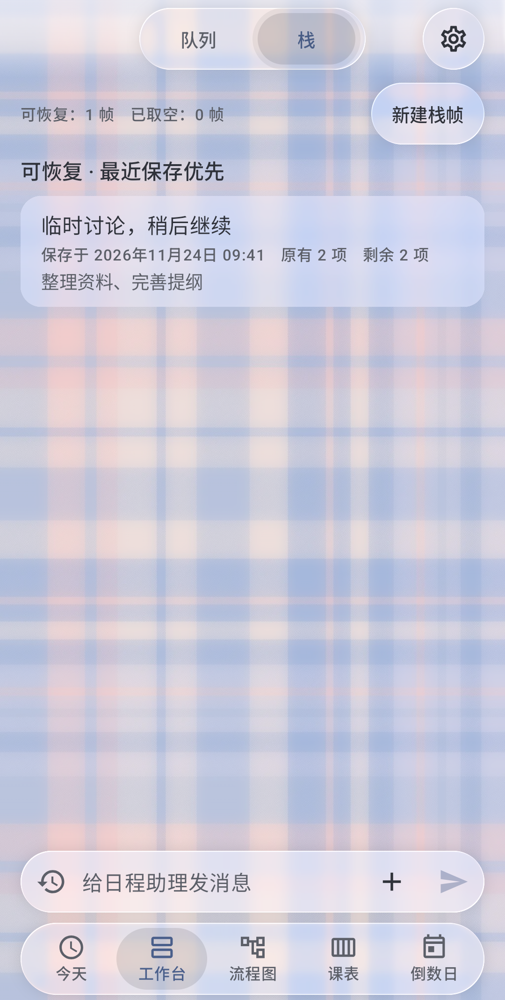
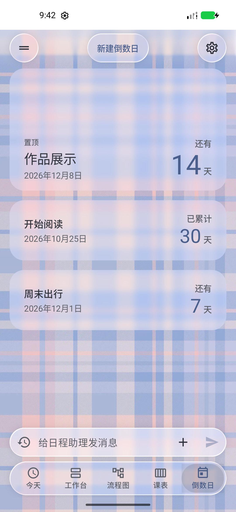

# StackLife

StackLife 是为 Android 手机设计的离线日程工具。用队列决定先做什么，被打断时把现场存进栈帧，回来后接着做。

[](app/build.gradle.kts) [](LICENSE) [](https://github.com/Nakanomk/StackLife/actions/workflows/android-ci.yml)

## 下载与安装

**[公开下载 · GitHub Releases](https://github.com/Nakanomk/StackLife/releases)**。在 Assets 中选 `StackLife-版本号-preview.apk`，打开后按 Android 提示允许从当前来源安装。[0.10.17 公开预发布](https://github.com/Nakanomk/StackLife/releases/tag/v0.10.17) 本身没有内置更新器。

如果手机上的 `versionCode` 高于下载页面的 APK，请保留手机上的版本。Android 会拒绝降级覆盖；不要为了安装旧版而卸载，卸载可能丢失本地日程。

从 **0.10.20** 起，打开应用默认每天最多向本仓库检查一次更新，预发布也会检查。在「设置 → 帮助与关于 → 版本与项目」可以立即检查、关闭联网检查或开启「自动更新」。自动更新默认关闭；开启后会下载并校验新版，在 Android 允许时自动覆盖安装，否则提示你授权或确认。不会卸载旧版。

## 初次使用

从 **0.11.0** 起，新用户可以在首次引导末页点「添加示例并完成」。随后打开「工作台 → 队列」：点开带「练习」的任务卡，**笔记**里有可以照着做的步骤。

四项练习围绕一次摄影散步：调整队列优先级，从「摄影包」栈帧取回装备，按流程图准备第一张照片，再把七天后的倒数日改成自己的出发日。它们都是可编辑、可移除的本机记录，不会自动排程或发提醒。不想添加就取消勾选，或直接选「稍后」。升级、重看引导和清空队列都不会补入示例。

## 界面

<table>
<tr>
<td align="center" width="33%"><a href="docs/images/today.png"></a><br>今天 · 时间轴</td>
<td align="center" width="33%"><a href="docs/images/workspace.png"></a><br>工作台 · 队列</td>
<td align="center" width="33%"><a href="docs/images/stack.png"></a><br>工作台 · 栈</td>
</tr>
<tr>
<td align="center"><a href="docs/images/graph.png"></a><br>流程图</td>
<td align="center"><a href="docs/images/timetable.png"></a><br>课表</td>
<td align="center"><a href="docs/images/countdowns.png"></a><br>倒数日</td>
</tr>
</table>

v0.10.17 源码运行截图，示例数据。2026-11-24 在 Pixel 5 配置的 API 37 模拟器上，用临时 debug 测试夹具采集原生窗口；竖屏 1080 × 2340、440 dpi、系统字体 1.0 倍、中文、上海时区。外观为浅色、种子色 `#435D92`、减弱动效。点图可看原始尺寸。

## 可以做什么

- **工作台**：按优先级排列任务，记录时长和备注。整队或选中几项即可压栈；恢复时移回原任务，保留眼前未完成的工作和当时的快照。
- **今天**：在时间轴拖放安排任务，或切到事件列表查看空档。支持单次、重复和重叠日程，可按某一次调整时间与提醒。
- **课表**：手动录课，或从华中科技大学 HUB 网页、本人导出的周表 JSON 导入。核对学期、节次和教室再保存；课程同时显示在周表与当天日程里。
- **流程图**：连接模板节点，也可引用已有任务。选定目标后，预览它和前置步骤的顺序，再加入队列或另存栈帧。
- **倒数日**：置顶将来的日期，或从过去的日期累计天数；不占用时间轴。

备注可用 Markdown 和图片。手动规划无需账号或模型；若要用日程助理，可在设置中连接自己的 OpenAI 兼容服务（BYOK）。

## 数据与权限

日程、备注、图片和对话历史保存在设备上。系统云备份与设备迁移已在 [Manifest](app/src/main/AndroidManifest.xml) 和[数据提取规则](app/src/main/res/xml/data_extraction_rules.xml) 中关闭，目前没有完整的日程备份导出。

HUB 在线登录、外部模型请求和 GitHub 更新检查需要网络。更新器不发送日程、对话或 API Key。发送模型消息前可查看接收服务并选择共享范围；跨页数据、备注和课程详情需另行选取。模型只能查询或提出更改，逐项差异经你确认后才在本机提交。API Key 由 Android Keystore 中的密钥加密保存。

通知权限用于显示日程提醒；精确闹钟用于按时触发，未获授权时提醒可能延迟。开机广播让应用在重启后重新安排提醒，唤醒锁只在处理提醒时短暂保持 CPU 运行。

## 当前验证范围

0.10.17 已在 API 37 模拟器上运行。相比 0.10.16，已有对照发现打开卡片耗时回退；本版尚无固定真机帧率结果。本人 HUB 在线登录与真实外部 BYOK 调用尚未验收。

普通版使用 Compose 转场，不含联盟 SharedView Kit；SDK 分发授权与支持设备上的系统转场均未核实。低于 API 33 时玻璃材质回退为实色，日程操作仍可用。

## 从源码构建

使用 JDK 21、仓库自带的 Gradle wrapper 和 Android SDK。0.10.17 使用 Gradle 9.6.0、AGP 9.5.0，源码 Java target 为 17。当前分支的版本见 [`app/build.gradle.kts`](app/build.gradle.kts)；复现预发布请先检出 [`v0.10.17`](https://github.com/Nakanomk/StackLife/tree/v0.10.17)。

```sh
sdkmanager 'platform-tools' 'platforms;android-37.2' 'build-tools;37.0.0'
./gradlew --no-daemon --stacktrace :app:testDebugUnitTest :app:assemblePreview
```

普通版不需要联盟 SDK。产物为 `app/build/outputs/apk/preview/app-preview.apk`。本地 `preview` 使用本机 debug 签名，CI artifact 使用 runner 的临时签名，仅供测试；覆盖更新公开预览版请用 Release 中的 APK。

## 发布与校验

[Android CI](.github/workflows/android-ci.yml) 检查主分支和 PR。[预发布工作流](.github/workflows/release.yml) 从 `main` 手动运行，输入带注释的版本标签；它按标签解析出的完整提交构建，在独立任务中签名并离线验证首次启动和重启。

在同一目录下载 APK、`SHA256SUMS` 和 `BUILD-INFO.json`。`sha256sum -c SHA256SUMS` 校验 APK 和构建记录的文件内容；`BUILD-INFO.json` 给出源码标签、提交和 Actions 运行链接。APK 的签名证书另用 Android build-tools 核对：

```sh
apksigner verify --verbose --print-certs StackLife-0.10.17-preview.apk
```

公开预览签名证书 SHA-256：`6a51915f4e57205dfd4e5f1bee5bac6c14434e7bdaa2050c165975a512b758d9`。该指纹识别签名者，与每个 APK 各自的文件摘要不同。

## 反馈、许可与致谢

在 [Issues](https://github.com/Nakanomk/StackLife/issues) 报告问题时，请附应用版本、Android 版本与复现步骤，隐去课表、账号和密钥。功能约定和验收依据见[产品路线图](docs/roadmap.md)。

StackLife 使用 [GPL-3.0-or-later](LICENSE)。本次 APK 对应的源码可在 [v0.10.17 Release](https://github.com/Nakanomk/StackLife/releases/tag/v0.10.17) 的 **Source code** 档案中取得。

感谢 [BiliPai](https://github.com/jay3-yy/BiliPai) 提供浮动导航、壁纸和输入框的实现参考；课表提取与节次表移植自 WadwaitaUp，流程图使用 KotlinFlow 和 JGraphT。时间布局、提醒和倒数日分别借鉴 FullCalendar、Etar／Tasks.org 和 TimeTrace；字级与周表交互参考 Now in Android、WakeUp。各组件及移植文件的作者、出处与许可见[随包声明](app/src/main/assets/licenses/)。
