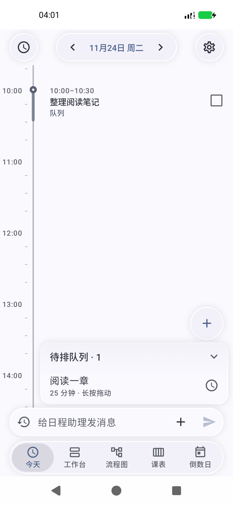
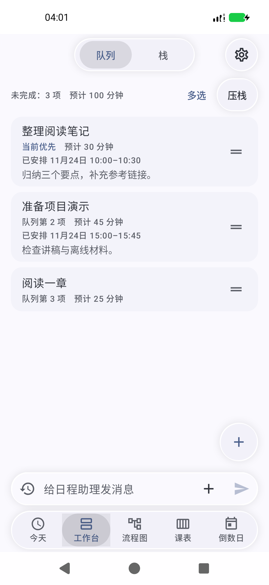
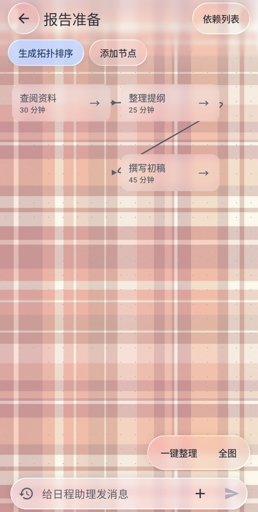
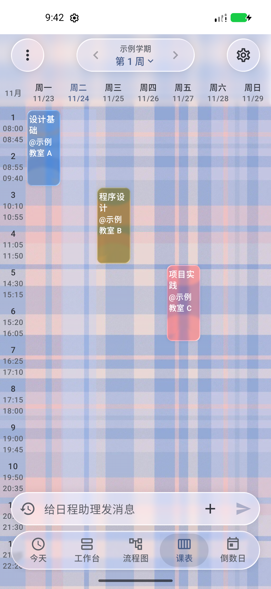

# StackLife

StackLife 是为 Android 手机设计的离线日程工具。用队列决定先做什么，被打断时把现场存进栈帧，回来后接着做。

[](app/build.gradle.kts) [](LICENSE) [](https://github.com/Nakanomk/StackLife/actions/workflows/android-ci.yml)

## [下载 Android APK · 0.11.1 预发布](https://github.com/Nakanomk/StackLife/releases/download/v0.11.1/StackLife-0.11.1-preview.apk)

[本版更新说明](https://github.com/Nakanomk/StackLife/releases/tag/v0.11.1) · [历史版本](https://github.com/Nakanomk/StackLife/releases)

## 初次使用

从 **0.11.0** 起，新用户可以在首次引导末页点「添加示例并完成」。随后打开「工作台 → 队列」：点开带「练习」的任务卡，**笔记**里有可以照着做的步骤。

四项练习围绕一次摄影散步：调整队列优先级，从「摄影包」栈帧取回装备，按流程图准备第一张照片，再把七天后的倒数日改成自己的出发日~它们都是可编辑、可移除的。你可以用它们来熟悉这个软件的操作。

## 界面

<table>
<tr>
<td align="center" width="33%"><a href="docs/images/today.png"></a><br>今天 · 时间轴</td>
<td align="center" width="33%"><a href="docs/images/workspace.png"></a><br>工作台 · 队列</td>
<td align="center" width="33%"><a href="docs/images/stack.png"></a><br>工作台 · 栈</td>
</tr>
<tr>
<td align="center"><a href="docs/images/graph.png"></a><br>流程图</td>
<td align="center"><a href="docs/images/timetable.png"></a><br>课表</td>
<td align="center"><a href="docs/images/countdowns.png"></a><br>倒数日</td>
</tr>
</table>

## 可以做什么

- **工作台**：按优先级排列任务，记录时长和备注。整队或选中几项即可压栈；恢复时移回原任务，保留眼前未完成的工作和当时的快照。
- **今天**：在时间轴拖放安排任务，或切到事件列表查看空档。支持单次、重复和重叠日程，可按某一次调整时间与提醒。
- **课表**：手动录课，或从华中科技大学 HUB 网页、本人导出的周表 JSON 导入。核对学期、节次和教室再保存；课程同时显示在周表与当天日程里。
- **流程图**：连接模板节点，也可引用已有任务。选定目标后，预览它和前置步骤的顺序，再加入队列或另存栈帧。
- **倒数日**：置顶将来的日期，或从过去的日期累计天数；不占用时间轴。

备注可用 Markdown 和图片。手动规划无需账号或模型；若要用日程助理，可在设置中连接自己的 OpenAI 兼容服务（BYOK）。

课表默认不画节次和日期的辅助线。初始背景是「雾蓝格」（第 3 张）；在「设置 → 外观 → 背景图片」可从四张内置格纹中选一张，用于全局或单独某个页面，也可改用纯色或自己的图片。「设置 → 外观 → 材质与动态」可重新打开课表辅助线。

## 从源码构建

安装 JDK 21 和 [Android SDK](docs/guide.md#构建环境)，在仓库根目录运行：

```sh
./gradlew :app:assemblePreview
```

APK：`app/build/outputs/apk/preview/app-preview.apk`。

## 发布与校验

维护者推送带注释的版本标签后，打开 [Android prerelease](https://github.com/Nakanomk/StackLife/actions/workflows/release.yml)，点 **Run workflow**，分支选 `main`，填入标签。

下载同一版的 APK、`BUILD-INFO.json` 和 `SHA256SUMS`，在下载目录运行：

```sh
sha256sum -c SHA256SUMS
```

[数据与权限、验证范围及签名说明](docs/guide.md)

## 反馈、许可与致谢

在 [Issues](https://github.com/Nakanomk/StackLife/issues) 报告问题时，请附应用版本、Android 版本与复现步骤，隐去课表、账号和密钥。功能约定和验收依据见[产品路线图](docs/roadmap.md)。

StackLife 使用 [GPL-3.0-or-later](LICENSE)。每版对应的源码在该版 Release 的 **Source code** 中。

感谢 [BiliPai](https://github.com/jay3-yy/BiliPai) 提供浮动导航、壁纸和输入框的实现参考；课表提取与节次表移植自 WadwaitaUp，流程图使用 KotlinFlow 和 JGraphT。时间布局、提醒和倒数日分别借鉴 FullCalendar、Etar／Tasks.org 和 TimeTrace；字级与周表交互参考 Now in Android、WakeUp。各组件及移植文件的作者、出处与许可见[随包声明](app/src/main/assets/licenses/)。
