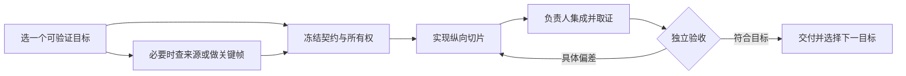

# StackLife 长线产品与验收路线图

StackLife 是用 Kotlin + Jetpack Compose 开发的、手机优先的原生 Android 日程工具。**队列**回答「我现在要做什么」，**栈帧**记录「我为什么停下、怎样接回去」。**DAG** 决定为选定目标先做什么，**时间轴**决定哪天几点做，**课表**标出已经占用的时段。一项工作不因换视图而变成几份任务。

**项目许可：** StackLife 采用 [GNU 通用公共许可证第 3 版或任何后续版本](../LICENSE)（`GPL-3.0-or-later`）。第三方代码与资源保留[各自的许可和署名](../app/src/main/assets/licenses/)。

**当前候选版本：v0.11.0（36），Room v13。** [首次使用示例](#v0110-首次使用示例)只由新用户在引导中确认创建；旧库升级不填充日程。M1–M6 是历史契约；原本“冲突拒绝写入”“节点都是模板”等规则已由[排程与链接升级](#v01012-排程链接倒数日与外观)替代。普通包不含联盟 SDK。

## 起点与产品决定

- 规划时仓库仅有 `.git/`，无可迁移的 App 或项目级 Agent 文件。架构从 [Android 官方建议](https://developer.android.com/topic/architecture/recommendations) 起步，不复制大型示例的模块拓扑。
- 本文的 `../WadwaitaUp/…` 均相对 **StackLife 项目根目录**。`browser.py:37–62,103–169` 有真正的 HUB/Vue 提取路径；`models.py:33–62` 有夏/冬两套 12 节表。这是桌面来源，不是可装到 Android 的插件。
- 规划时本机有 Android Studio、`adb`、JDK 17/21，系统默认 Java 27。`~/Android/Sdk/platforms` 仅有 `android-36.1`，37.0 的 x86_64 镜像目录仅见 `.installer`，`~/.android/avd` 为空。不能当成可启动设备；规划阶段未装 SDK、未启设备、未运行应用。
- 恢复默认按帧内原序插队首，可改队尾或整帧切换，不得覆盖眼前未完成的工作。「顶级」指**选定的目标事件**：取前置及目标本身的合法顺序，不做截止时间倒排。
- 日程留在设备。模型连接可选官方预设或自定义 OpenAI 兼容地址，由用户提供自己的 API Key。「接口」指 UI 和模型共用的本地业务接口；不监听端口、不对外开放。模型可查询和提案，不能确认写入。
- 华科网页导入参照 [WakeUp 的教务导入流程](https://www.wakeup.fun/doc/import_from_eas.html)：手机登录、进入课表、点提取、核对。只借交互，不复制源码。网页和本人导出的 JSON 共用 Kotlin 解析器和确认事务；不采集密码、Cookie，不把校方页面给模型。

## 交付顺序

|阶段|依赖|可验收的用户结果|
|---|---|---|
|M0 约束落盘|无|根 `AGENTS.md` 提供执行入口，`docs/roadmap.md` 保存产品契约、依据、里程碑与验收表。只留两份长期文档。|
|M1 可以放心中断|M0|可安装的原生应用：真实队列、带原因的持久栈帧、整帧/部分恢复及三种策略。从第一屏使用 Expressive 主题和 fumo 图标；只显示已可用的目的地。|
|M2 安排今天|M1|从同屏托盘把队列任务拖到当天时间轴，时间选择器可做等价操作。|
|M3 课表占位|M2|华科用户本人登录或选文件，预览、导入、看周课表；课程占用同一条日程轴。|
|M4 从目标拆解工作|M1；与 M2 独立|手绘编辑 DAG，预览所选目标的前置顺序，一次生成新栈帧，不扰动队列。|
|M5 用对话改真实日程|M1–M4|各业务页可打开轻量对话，BYOK、受限查询、一次确认整批写入；不配网络也能手动使用。|
|M6 自定义与系统动效|M1–M4；助理入口材质验收需 M5|完整外观设置、可开关的局部折射、联盟 SharedView Kit 适配与真机流畅性验收。基础无障碍和应用内转场从 M1 就做。|

## 原生底座与本地事务

从 M1 随切片增加，不先造一套空框架。只建一个生产 `:app`，包名 `io.github.nakanomk.stacklife`。主 Activity + 按功能分包的 Compose 屏幕；只有联盟系统路径另需一个不导出的详情 Activity。应用级容器做构造器注入；ViewModel 暴露 `StateFlow`，页面用 `collectAsStateWithLifecycle()`。不建服务端、微服务、动态插件框架或每按钮一个 use case。

|构建面|规划锁定与依据|
|---|---|
|平台与界面|`compileSdk 37.2`、`targetSdk 37`、`minSdk 26`（涵盖联盟 Kit 下限）。[Compose 稳定发布](https://developer.android.com/blog/posts/jetpack-compose-november-2026-release)对应 BOM `2026.11.01` / Compose `1.13.0` / Material3 `1.5.0`。|
|工具链|[AGP 9.5.0 / Gradle wrapper 9.6.0 / JDK 17](https://developer.android.com/build/releases/agp-9-5-0-release-notes)，用 [AGP 内建 Kotlin](https://developer.android.com/build/migrate-to-built-in-kotlin)；Compose 编译插件和序列化插件统一 Kotlin `2.4.10`，KSP2 `2.3.14`。|
|导航与存储|[Navigation 3 `1.2.2`](https://developer.android.com/jetpack/androidx/releases/navigation3)、[Room `2.8.5`](https://developer.android.com/jetpack/androidx/releases/room)。版本集中在 `gradle/libs.versions.toml`，不用 `+`、snapshot 或 beta BOM。|

本地入口在 `app/src/main/java/io/github/nakanomk/stacklife/planner/PlannerApi.kt`。`discard` 只撤销未消费的内存提案，不写业务表：

```kotlin
interface PlannerApi {
    fun observe(query: PlannerQuery): Flow<QueryResult>
    suspend fun preview(commands: List<PlannerCommand>): PreviewResult
    suspend fun commit(proposalId: String): CommitResult
    fun discard(proposalId: String)
    fun stageCourseImport(term: TermSpec, meetings: List<CourseMeeting>): String
    fun discardCourseImport(draftId: String)
}
```

- `PlannerQuery`、`PlannerCommand` 为封闭类型，随里程碑加入真实操作。Compose 订阅 Flow，对话只取一次。UI、导入器、LLM 不直接拿 DAO。明确的手动点击可在内部连续预览/提交，无额外确认框；模型**没有 `commit` 工具**。需选文件、登录、授权等动作返回 `UserActionRequired`，不可报成已完成。
- `preview` 在同一读快照中按顺序校验整批命令，分配批内新增实体的 ID，算出明确增删改和 `baseRevision`。已声明的批内唯一别名可供后续命令引用；未声明、重复或歧义则拒绝。不可变提案及差异只留本机内存，不写业务表。
- M3 两个 `stage/discardCourseImport` 草稿方法只接收本人已核对的课次，在设备内存中临时登记；原始 JSON、网页登录数据不进 `PlannerApi`。预览取得独立差异后即释放输入草稿，未确认不改 Room。
- `commit` 只消费本机生成的对应提案。Room 写事务复核全局业务修订号，仅落下已预览的变更，修订号加一。过期返回 `STALE_PREVIEW`，须重新预览；不再询问模型决定写什么。重复点不能生第二份，取消/进程死亡丢弃未确认提案，中途失败整批回滚。校验只写一处。
- 非敏感外观与恢复偏好放在同库一行，保证与日程混合写入时仍能原子提交；密钥不进 Room。应用私有空间持久化，日程、登录数据与密钥不进系统云备份。Room 升级写迁移，不销毁重建。自行实现的是本项目的归属/快照、命令语义和交互连接；画布、主题、布局、解析依据与材质均有下列参考。

## M1 工作台

**一份任务，一个当前归属，一份可回看的现场。** `Task` 有稳定 ID、标题、备注、预计分钟、归属、位置；归属只有 `QUEUE / FRAME / DONE / REMOVED` 之一，仅 `QUEUE` 有队列序号，仅 `FRAME` 有当前帧 ID。`Frame` 记原因、保存时间、来源；`FrameItem` 记帧 ID、原位置、任务 ID、当时的标题/备注/时长以及当时已有的排程起止。历史项只读，不随任务编辑回写。删除用移出标记，不级联删帧历史；只有任务仍归该帧时才可恢复。

工作台分「队列 / 栈」。队列可新增、编辑、完成、移出、拖排/菜单移动；显示未完成数及预计总时长。队首是当前优先项，不强制计时；显示排程也不按时间重排队列。标题非空，预计时长为正，未填默认 30 分钟。手柄借 [Reorderable 3.1.0](https://github.com/Calvin-LL/Reorderable) 的稳定 key、拖动、边缘滚动，结束才提交新次序。栈按保存时间倒序，最新可恢复帧优先；原因作标题，显示保存时刻、原始项目和剩余数。取空的帧仍可看历史，也可在栈内直接新建一帧事件清单。

- **压栈：**点「压栈」立即按原序保存整个未完成队列；「多选 → 压入所选」只移动勾选项。原因可空，不弹预填对话框。事务成功后才在底部显示「已压栈 · 补充原因」；保存原因只更新本次回执指定的帧，关闭提示不影响栈帧。无原因时显示「暂存的队列」，不写假原因。空集合、失效选项及事务失败均不建帧。反馈参考 BiliPai 的[底部宿主](https://github.com/jay3-yy/BiliPai/blob/5893c2c80739e3759ac64ae5f232cf03a94da7f8/app/src/main/java/com/android/purebilibili/feature/home/HomeScreen.kt#L2576-L2582)和[下载成功后的附加动作](https://github.com/jay3-yy/BiliPai/blob/5893c2c80739e3759ac64ae5f232cf03a94da7f8/app/src/main/java/com/android/purebilibili/feature/home/HomeBatchDownload.kt#L170-L181)，未移植 GPL 代码。
- **恢复：**手动「全部恢复」一次执行；「选择恢复」按帧内源序而非勾选顺序。已取走/完成/移出的项不复活、不重复。操作与预览均说明实际策略。空帧即使连点也不触发切换。
- **帧内编辑：**点帧内尚未取走的任务旁的「编辑任务」，可改标题、备注和时长，无需先恢复。恢复移动修改后的原任务；已取走的条目只读。历史帧保存时的文字和时长不回写。事务会核对帧归属，不把过期编辑应用到另一帧。

|本机偏好|全部恢复帧 `[A,B]` 到当前 `[X]`|选择恢复|
|---|---|---|
|`PREPEND`（默认）|`[A,B,X]`|所选按原序插队首。|
|`APPEND`|`[X,A,B]`|所选按原序加队尾。|
|`SWAP`（整帧切换）|`[A,B]`；先把 X 存为原因「切换栈帧前自动保存」的新帧。|始终插队首；只选 B 得 `[B,X]`，不另存 X。|

只有「全部恢复」且策略为 `SWAP` 且当前队列非空，才自动保存眼前队列，与恢复同一事务；失败/取消不改队列、两帧或次序。**占位独立于工作归属**：压栈保留预约，轴上注明「已压栈 · 仍占用时段」；恢复不复制、不改时，旧快照不覆盖用户后来的安排。

**清理历史。** 详情可删除一条已取空的栈帧，栈列表「清除历史」可一次删除确认时所列的空帧。两者都先说明数量和不可撤销，再在同一事务删除快照与帧，不移除任务、不释放预约。帧内仍有未完成任务或确认期间状态改变时不执行。

## M2 今天

**完成、作息与提醒。** 时间／事件视图的右侧复选框与正文、拖动手柄各自响应。任务完成仍保留时段；取消完成回原栈帧或原队列位置。原帧已清除，或旧版本未记录原归属时，放回队尾，不复活历史。固定课次按来源、学期及具体课次独立打勾。起床／就寝参照 [Structured 日时间轴](https://help.structured.app/en/articles/380546)；在设置最上方分别设定或清除，默认都未设置。按设备当地日期显示为不挤占其他预约的时间点。完成只影响当天；夏令时跳时向后顺延，重复小时取第一次，整日不存在则跳过。

系统提醒使用 [Android AlarmManager](https://developer.android.com/develop/background-work/services/alarms) 与[通知运行时授权](https://developer.android.com/develop/ui/views/notifications/notification-permission)。只为已排程且未完成的任务、课次与作息提醒，默认提前 15 分钟；进入提前窗口才添加的立即提醒，已经开始的不补发。同刻合并。改时、取消和完成后重新核对，不靠常驻轮询。重启、更新、改时区后重新安排；锁屏不展示内容。Android 13+ 在设置中请求通知；未获精确闹钟权限时使用可能延迟的系统提醒。

完整导航为「今天 / 工作台 / 流程图 / 课表」，设置从顶栏进；今天默认设备所在日期。时间轴延伸至日程助理输入栏的上沿，不藏在输入栏或导航下面。右下加号下的**非模态**待排队列默认展开；点标题可收成小球，再点原地展开，收起后时间轴仍用满输入栏上方的空间。切日、切页和旋转不重置用户刚选的开合状态。收起时箭头向上，展开时向下，队列上缘渐变磨砂。「布局 → 待排队列」可改回常驻托盘。待排指无时段的在队任务。轴和拖动参考 [Structured](https://structured.app/visual-planning) 与 [Planner Hours](https://github.com/baslawson/Planner#features)，小球变列表参考 [Material Container Transform](https://github.com/material-components/material-components-android/blob/master/docs/theming/Motion.md#container-transform)。

队列是覆盖层：开合不改变轴线、滚动位置或拖放的时刻映射。收起的小球与加号同为 56dp。左上圆钮用时钟／事件列表图标表示当前视图，点开才显示选项文字。**时间视图**保留比例刻度；只有滚到日末时，当地次日零点、「一天结束」下沿和竖线末端一起停在助理上方 16dp。这段间距不能落任务，也不续画空线；平时不为它截短时间轴。展开队列时末刻显示在左侧时刻栏，收起队列可直接点开深夜任务。**事件视图**沿用原布局：竖线贯穿至助理上沿，列表保留让末项滚出队列遮挡区的余量。参考 [Structured Full 布局](https://help.structured.app/en/articles/354306#2_change_app_layout)，左侧标刻、沿线排列任务和固定课。连续空档只占一行，注明真实时长；点该行可将新任务直接排入其中。根据重叠时段的并集取空档，跨日裁剪、夏令时和空白日均按当地日界计算。

- Compose 可滚动刻度接[原生拖动手势](https://developer.android.com/develop/ui/compose/touch-input/pointer-input/drag-swipe-fling)。长按拖动，边缘滚动；指针换算为含滚动偏移的轴内容坐标，按 5 分钟就近吸附。预览半透明落点、起止与冲突。松手才落库；轴外、取消、目标失效不改原数据。「安排时间」打开同一日期/时间/时长编辑器，无需拖动也可完成全部安排。
- `TimeBlock(taskId UNIQUE, startInstant, endInstant)` 引用原任务。长按标题拖动整段；长按任务旁竖条，松开后直接拖下端点，只改结束时间，起点不动。交互参考 [Google 日历的底部圆形时长手柄](https://support.google.com/calendar/answer/72143?co=GENIE.Platform%3DAndroid)和 [FullCalendar 的触摸选择](https://fullcalendar.io/docs/touch)。课程、完成项和没有真实结束点的续段不提供手柄。取消只释放时段；移出任务释放占位，完成任务保留历史块。
- 用当地午夜到次日午夜换算一天，不假定恒为 24 小时。跨日按日裁剪显示，底层仍一条；课程按学期换算到同一时间基准。冲突按半开区间 `[start,end)`，移动排除自身。撞已有预约或固定课程须指出具体冲突并保留原状，不推走别项。课程导入撞上既有块则预览、标记双项，不抹掉用户安排。

已实现 `PlannerQuery.Day(date, zone)`：一次事务读出同修订号的待排队列与当日相交的原始时段。`SlotSet(taskId, start, durationMinutes, expectedRevision)` 新增或移动，`SlotClear` 只释放占位；拖动读到的旧修订不可覆写新日程。两条界面路径共享 `preview/commit`。编辑器标明时区，拒绝不存在的当地时刻；秋季同一时刻出现两次时可选 UTC 偏移。Room v2 只新增占位表和索引，没有新增运行依赖。

## M3 华科课表

`SchoolImports` 编译期登记真正可用的学校，现在仅华科（`hust-hub`）。每校提供采集入口、原始格式解析／纠错、帮助、时区和节次表。通用预览与存储接收 `ReviewedTimetable(source, term, meetings)`；重导和删除只作用于同来源、同学期。同学期多来源且未指定学校时不会猜测，手动课程独立。新增学校不需要修改「今天」或新增数据库表。华科的纯 Kotlin 解析器无网络、DAO 或密码，两种已知输入共用解析／预览：

1. 「从 HUB 网页提取课表」在手机内打开[校方登录页](https://hubs.hust.edu.cn/login)。本人完成认证后点「总课表」，选学期，点「提取」进入学期确认，无需电脑或中间文件。`app/src/main/assets/importers/hust-hub.js` 的 Vue 父链查找依据 `../WadwaitaUp/browser.py:37–62`。
2. Android 系统文件选择器选本人导出的原始周数组 JSON；格式依据 `../WadwaitaUp/tools/hust_converter.py:6–16,84–100`。不架中转服务，不承诺兼容未核实格式。

**独立浏览。** 先选导入方式；网页方式再选择实际支持的学校。「用浏览器浏览教务网站」通过系统 `ACTION_VIEW` 打开固定登录入口，不传认证重定向、DOM 或 Cookie，不指定 Chrome。这一入口只浏览，不提取。

**浏览与提取分开。** 手机提取器用 [Android System WebView](https://developer.android.com/reference/android/webkit/WebView)。HTTP/HTTPS 页面及跨域验证交给 Chromium，不设校方域名白名单，不改写重定向。HTTP 是明文，App 不会把它变成安全连接。第三方登录 Cookie 仅限该会话；保留系统证书验证，不注册原生 JS bridge。只有当前显示的页面是 [HUB 总课表](https://hubs.hust.edu.cn/basicInformation/scheduleInformation/index) 且用户点提取，才运行 APK 内脚本；只取周次、日期、星期、课名、节次、教室。导航或换学期会使未完成的提取失效。

退出提取器清理其 WebView 站点数据，不清外部浏览器数据，也不代替校方登出。给用户安装的包用 `./gradlew :app:assemblePreview` 构建，路径为 `app/build/outputs/apk/preview/app-preview.apk`，不可调试、与上一版同签名。`debug` 包只用于开发。

**从原始行到实际上课日期。** `ZC` 为周序，周集合去重排序。按周保留课名 `KCMC`、星期、节次 `JC`、教室 `JSMC`；仅完全相同条目去重，同课换教室不能并掉。`JC` 完整匹配单节或数字区间，支持 `-`、`–`、`—`；倒序、越界、「实践」均保留原文待修正，不默认为第一节。`KS` 只是第一周日期候选。用户确认学期标识、首周周一、总周数和夏/冬作息，可指定中途切换作息的生效日，不猜当年校历。按 `Asia/Shanghai` 实际上课日期套用 `../WadwaitaUp/models.py:33–62` 的两套 12 节预设；来源没有的教师等字段留空。

**写入边界。** 展示差异、有效/待修正数、同名不同地点和冲突；有问题的条目须修正或明确排除。无课或无有效数据不得覆盖已有课表。确认后仅替换所选学期 `hust-hub` 来源的课程集合；相同内容重复导入无新增，不动用户任务、其他来源或学期。**不移植** `../WadwaitaUp/window.py:3155–3188` 的 `_apply_imported_courses` 按课名跳过/覆盖；同名不是身份。移除某学期课表也须预览，不删除工作台内容。

核对清单的上端和末尾都可预览差异，差异页两端都可确认，同一份提案只消费一次。校历、预约时刻、任务时长及导入纠错的周次／起止节次使用 [Android NumberPicker](https://developer.android.com/reference/android/widget/NumberPicker)，列的编排参考 [BiliPai 的时间滚轮](https://github.com/jay3-yy/BiliPai/blob/5893c2c80739e3759ac64ae5f232cf03a94da7f8/app/src/main/java/com/android/purebilibili/feature/settings/screen/ThemeTimeWheelPicker.kt)。关闭滚轮不写入默认值；作息切换日可清除，无效原文在明确修正前保留。内嵌 HUB 右下角的信息按钮提供「登录 → 总课表 → 切换到总课表 → 导入」说明，不读取登录页内容。

**离线录课。** 入口和字段分组参考 [WakeUp 官方录课说明](https://wakeup.fun/doc/add_course.html)。选择已有学期或填写新校历，填写课名、可选地点、上课周、星期和起止节次。预览列出实际课次，保存后同步显示在周表与当天时间轴；点手动课格可编辑或移除这一组课次。来源 `manual` 独立于 `hust-hub`，同名同地点也不相互覆盖。助理 `manual_course_add` 须先获得课程详情授权，跨周／学期还需相应范围；本机核对提案后才能写入。

单次导入预览先计数，再生成冲突明细。超过 256 对受影响的重叠时，提示检查源文件，不截断课次后提交；课名和教室各限 256 个 UTF-16 单元，超长进入可修正条目。日/周视图中一门课超过 8 个冲突对象时显示确切总数，避免把大量课程两两展开。

**阅读与失败路径。** 周视图按 [WakeUp](https://www.wakeup.fun/images/mobile3.png) 的「七日列 × 实际节次」排列。课块用已有的 [MaterialKolor](https://github.com/jordond/MaterialKolor/releases/tag/6.0.0) 生成 [HCT](https://github.com/material-foundation/material-color-utilities/blob/main/concepts/color_spaces.md#hct) 底色：按学期确定起始色相，再按课程序号错开色相；目标色度 39、明度 71–83，取自 WakeUp 白字周表的明亮色域，不跟随壁纸或深色主题调暗。课名、地点和冲突标记统一白字，描边默认关闭；「材质与动态」可预览并开启。同课跨周或换教室不变色。冲突并列，点课看教室、节次、实际起止及冲突；点日期或「课表选项 → 课程列表」提供等价入口。横向切相邻周，纵向滚节次，周次胶囊可直接跳周。切学期、导入和移除集中在课表选项。无课表时胶囊直接提供导入。当天实例仍是时间轴的锁定块。登录、加载或校园网失败不覆盖原课表，文件通过不代表在线登录通过。

周数读取 [Compose Pager](https://developer.android.com/develop/ui/compose/layouts/pager#page-state) 的手势方向与目标页：箭头、选周和横向拖动一开始就更新标题，回拉取消恢复原周；业务查询与助理范围不因为一次未完成的触摸而提前提交。

**许可。** 移植部分随附 `../WadwaitaUp/LICENSE` 完整 MIT 文本及 `Copyright (c) 2024–2026 Nakanomk`；不携带个人样本。

## M4 流程图

节点是计划模板，不是已有队列任务。存图、节点（标题、备注、预计时长、创建顺序、画布位置）和有向边（前置 → 后继）。画布可新建、改名、拖动、连线、删边/节点、平移缩放；手机另有点选两节点连线和可朗读依赖列表。删节点一起删关联边，不反向改写已生成任务与帧。

- 画布使用 [KotlinFlow 1.0.1 / MIT](https://repo.maven.apache.org/maven2/io/github/joaonart/kotlinflow/1.0.1/) 绘制有向边并处理平移、双指缩放与全图适配；不引示例皮肤、不当数据库。该版本内建节点拖动把取消和松手交给同一回调，`onConnect` 不派发；节点移动、箭头拖到后继的命中及取消由应用适配。库用物理像素，节点位置按 dp 保存。领域层拒绝自环、重复边、缺失/跨图端点、会成环的边；说明具体冲突，不留半条边或部分生成物。
- 选一个目标，取其**传递前驱和自身**的诱导子图，稳定拓扑排序；并列就绪节点按创建顺序，再按 ID，不用坐标或画布排版决定优先级。用 [JGraphT Core](https://jgrapht.org/) `org.jgrapht:jgrapht-core:1.5.3`（[上游双许可](https://github.com/jgrapht/jgrapht/blob/jgrapht-1.5.3/README.md)，StackLife 选用 LGPL 2.1，同时保留 EPL 2.0 原文）：`DirectedAcyclicGraph.addEdge/getAncestors`、包含目标的子图、带显式比较器的 [`TopologicalOrderIterator`](https://jgrapht.org/javadoc/org.jgrapht.core/org/jgrapht/traverse/TopologicalOrderIterator.html)。拖节点只保存布局。
- 「生成拓扑排序」打开同一张操作单：使用已选节点，或自动选择唯一终点；多个终点可手选。选目标即展示依次要做的事，不写库。点「加入队列」一次按序追加新任务，不动现有队列和帧；「存为栈帧」一次生成有序快照，不动当前队列。帧原因默认「为目标〈标题〉生成」，可修改。两者均校验用户看到的修订，数据变了才要求重新核对；重复点击不重复写入。
- 画布右下角「一键整理」按最长前置链从左到右分层，同层保持原序，未连线节点另排。沿每条边前置都在后继左侧；按节点实际高度留白。一次只提交坐标并适配全图，不动依赖、目标生成顺序、队列或历史帧。重复整理同一布局不增加修订。

## M5 对话

业务根页共用底部输入框：切页、切日或切周不会丢草稿；换页时非空草稿仍使用最初的范围。软键盘回车只换行，确认输入法候选也不发送。已配置服务时，点纸飞机或在实体键盘按 Ctrl+Enter 才发送；未配置时保留草稿，保存服务不会代发。参考 [Telegram Android 输入栏](https://github.com/DrKLO/Telegram/blob/master/TMessagesProj/src/main/java/org/telegram/ui/Components/ChatActivityEnterView.java)与[消息气泡](https://github.com/TelegramMessenger/Telegram-Android/blob/21f7d109da6ab3506c9e9577f98c6a38771ab335/TMessagesProj/src/main/java/org/telegram/ui/Cells/ChatMessageCell.java#L19055-L19067)；圆形 `!` 收起提示、警告、错误及可选的数据范围。原始课表、HUB 登录与密钥页无助理。

**连接。** 用 OkHttp `5.5.1` + `kotlinx.serialization`。用户提供含 API 前缀的 HTTPS base URL、模型、Key；在 base URL 后追加 `chat/completions`。使用 [OpenAI 兼容 function tools](https://platform.openai.com/docs/guides/function-calling) 和 `tool_calls`，不从散文猜命令；模型必须支持这套协议，只支持 Responses 的不冒充兼容。用 [Android Keystore](https://developer.android.com/privacy-and-security/keystore) 中不可导出的 AES-GCM 密钥加密 BYOK，每次写用新 IV，密文放私有 `noBackupFilesDir`。换服务域需重新授权/填 key，不跨域转发鉴权。无账号、无托管中转、无后台自动操作。

运行时 HTTP 为 [OkHttp 5.5.1](https://github.com/lysine-dev/okhttp/tree/parent-5.5.1) 和 [Okio 3.18.1](https://github.com/lysine-dev/okio/tree/parent-3.18.1)，两者发布标签的 Apache-2.0 完整许可一并放在 APK 的 `assets/licenses/OkHttp-Okio-Apache-2.0.txt`。`MockWebServer` 和测试 TLS 证书仅在测试包。

**仅两种模型工具。** `planner_query` 限定类型、范围、字段，可查当前队列、帧/清单、图/目标次序、某天占位、某学期/周课表及普通设置；只读本轮获准范围。`planner_propose` 传一次有序命令数组。下表 `kind` 也是 UI 命令的序列化名。不提供 raw SQL、任意 URL/文件、脚本执行、任意 UI 点击或确认按钮；隐私、连接配置、认证、系统选文件都要显式用户操作。

|领域|写命令与关键输入|
|---|---|
|队列 / 栈|`task_add`（每项一条，可成批）、`task_edit`、`task_finish`、`task_remove`、`queue_order`（当前完整 ID 排列）；`frame_create(reason, tasks)`、`frame_push(taskIds, reason?)`、`frame_add_reason(frameId, reason)`、`frame_restore(frameId, mode, taskIds)`。`mode=all/selected`；是否切换队列由本机偏好决定。|
|DAG|`graph_create`、`graph_patch`（按 ID 增改删节点、位置、边）、`graph_remove`、`graph_frame(graphId, goalId, reason)`。新实体可声明批内唯一 `ref`；`graph_frame` 还可声明新帧 `ref` 和 `taskRefs`（图节点 → 新任务别名），让「生成 → 选取 → 排程」不猜数据库 ID。|
|日程 / 课表|`slot_set(taskId, start, durationMinutes)` 新排、移动或调整结束，开始须带 offset；`slot_clear(taskId)`。`manual_course_add` 按学期、周集合与节次提议手动课程；`course_import(draftId)` 必须使用用户核对的本地草稿；`term_remove(termId)` 仅移除 HUB 来源。|
|外观 / 偏好|`prefs_set`、`prefs_reset` 只接受已公开的外观/交互字段与合法值；重设只动所选组。配置凭据或扩大披露范围不能走模型授权捷径。|

**数据披露。** 配置时显示接收服务与默认范围。默认仅读当前页的任务标题、顺序、时段和必要 ID；课表默认只给忙碌时段。跨页、备注、压栈原因、课程名/地点须显式选取。改范围只影响下一次主动发送，不沿用旧对话上下文。整库、原始课表、Cookie 不发送；BYOK 仅作鉴权头，不进提示词或工具结果。课程名、备注和模型输出都是不可信文本。关闭对话取消在途请求。发送过的文字、回复和变更摘要留在本机；历史不保存草稿、密钥、原始工具调用或可执行提案，浏览不会把历史发给模型。

**谁能提交。** 纯查询直接答。每轮所有写操作合为**一张差异卡**，列项目名、顺序、旧 → 新时间、实际生成的节点/边/帧或受影响设置。模型没有 `commit` 工具；只有用户点一次「应用这些更改」，手机才消费对应本地提案，收到事务回执才说「已应用」。校验失败、重名歧义、空结果、协议不兼容、401、限流、超时、取消均给具体反馈，不写业务项。每条消息最多四次只读往返，写提案返回即停；不运行自主后台 Agent。

**使用。** 「设置 → 模型服务配置」可选 [DeepSeek](https://api-docs.deepseek.com/guides/tool_calls/)、[Claude](https://platform.claude.com/docs/en/cli-sdks-libraries/libraries/openai-sdk)、[GPT](https://developers.openai.com/api/docs/models/gpt-5.4-mini) 或自定义。预设填入官方 API 地址和可编辑的模型，用户填写 API Key，不是登录聊天软件账号。选择和保存均不联网，切换服务不携带未保存的密钥。点输入栏左侧的「历史对话」按最近消息浏览，未配置服务或重启后也可读；详情可删除整段，不能重放提案。每次最多接受一个工具调用；课程来源页只能问已保存数据，核对完成的差异页才可生成本地草稿 ID。模型要写日程仍须逐次确认差异，失效提案须重新预览。

点开历史对话后可直接在底部输入并发送。只从该条记录恢复最多 12 条已发送的用户/模型文字，同一条记录追加新消息；本机回执、旧提案、草稿 ID 和旧授权不作为对话上下文发送。输入栏上方显示这次使用的接收服务。Room v7 为新对话保留原页面定位；旧版只保存了显示名，能还原的日期或教学周沿用，不能还原的短实体 ID 不猜测，显示并使用打开历史时的页面。

## 设计与外观

基线是 Android 标准 Material 3。字形走平台 sans-serif 与中文回退，不分发苹方或按品牌模拟字形。页名使用 `titleLarge`（22/28sp），普通列表标题 `bodyLarge`（16/24sp），次要信息 `bodyMedium`（14/20sp），导航与时间刻度使用标签角色（12/16sp）。是否强调由信息角色决定，不把普通任务当成展示大标题。使用标准 motion scheme；减少动效仍然生效。

- 四个根页面在同一横向分页容器中，导航与助理位于容器外。默认浮动导航，支持改为贴底；键盘出现时收起主导航。根页不重复页名，顶栏中间胶囊放日期、队列/栈、流程图创建或教学周；独立动作用圆形按钮。右下加号属于页面。手动操作不依赖模型。
- 设置首页先显示「日程与作息」，随后是外观、通用、日程助理和工作台恢复策略。「色彩」「布局」「材质与动态」各有独立目的地，只显示、保存或恢复本页字段。色彩支持随系统/浅/深、Android 12+ 动态色或种子（默认 `#435D92`）；使用 [MaterialKolor 6.0.0](https://github.com/jordond/MaterialKolor/releases/tag/6.0.0) 生成 `SPEC_2025` 颜色角色。
- 「通用 → 语言」使用和外观相同的[单选项设置](https://github.com/jay3-yy/BiliPai/blob/5893c2c80739e3759ac64ae5f232cf03a94da7f8/app/src/main/java/com/android/purebilibili/feature/settings/SettingsSelectionComponents.kt#L14-L45)：**跟随系统**（默认）、**English**、**中文**。跟随系统按语言顺序选择中／英文，均不匹配或列表为空时用英文。Android 13 起与[系统的应用语言设置](https://developer.android.com/guide/topics/resources/app-languages#app-language-settings)双向同步，旧系统在本机保存。语言选择不改任务、课程、栈帧快照和历史对话原文。
- 「通用 → 帮助与关于」参照 [BiliPai 关于页](https://github.com/jay3-yy/BiliPai/blob/5893c2c80739e3759ac64ae5f232cf03a94da7f8/app/src/main/java/com/android/purebilibili/feature/settings/ui/MaterialAboutContent.kt)，列出开发者、仓库、实装版本、基础 APK 和签名证书各自的 SHA-256。「开源许可」可离线阅读 StackLife 与第三方组件的许可全文。诊断仅在主动开始后监听主窗口的 [FrameMetrics](https://developer.android.com/reference/android/view/FrameMetrics)，退到后台即结束；帧超时和丢失采样分别计数。事件日志只含固定代码，不含账号、密钥、任务或消息正文；只有手动选择[系统文件位置](https://developer.android.com/training/data-storage/shared/documents-files#create-file)才会导出。
- 关于页四项菜单和许可正文都从实际点到的行展开，返回收回该行；保留各列表位置并响应预测返回与减弱动画，不把抽屉动效用于全页。「版本与项目」和许可列表顶部都能离线打开与仓库 [`LICENSE`](../LICENSE) 相同的 GPL 文本。项目声明为 `GPL-3.0-or-later`，第三方声明单列。
- 支持标准/紧凑留白、主导航次序/启动页、任务时长/备注、贴底/浮动、常驻/悬浮队列、材质总开关和导航/助理分项、减弱动效、减少透明度、增强对比及系统触感。默认舒适、今天、动态色、悬浮队列、玻璃开启。首次启动和升级时没有 `glass` 字段的配置均用开启；显式 `false` 不因升级改变，减少透明度和增强对比仍优先。三种恢复策略不受外观重置影响。
- 首发图标为原创 fumo 颜文字 **`ᗜˬᗜ`**：两只对称方眼和低位短弧嘴，用独立矢量笔画，不依赖字库、商业布偶照片，不强画天子肖像。按 [Android Adaptive Icon](https://developer.android.com/develop/ui/views/launch/icon_design_adaptive) 做 108×108 dp 分层，识别区在中心 66×66 dp，彩色前景/背景及 monochrome 层共用轮廓，不预烘启动器圆角/阴影。空队列小标沿用同一张脸，不用颜文字代替操作标签。

设置草稿只存在于编辑页；退出不写库，保存使用 `PlannerApi` 的同一预览/提交事务。持久化契约是 `planner/Appearance.kt`，Room 4→5 为原设置行加入缺省 `{}` 的外观字段，不迁移队列、快照、时段或模型凭据。主题/平台能力、局部绘制和设置编辑分别在 `StackLifeTheme.kt`、`appearance/`；业务页只读取对应偏好。以后替换导航及页面布局不需要更改排程或恢复规则。

**交互参考与借用边界：**

|来源|具体借用点|
|---|---|
|[Now in Android 字级](https://github.com/android/nowinandroid/blob/2982e63cb691ad49cd009aab43dc206fee6699c2/core/designsystem/src/main/kotlin/com/google/samples/apps/nowinandroid/core/designsystem/theme/Type.kt) / [顶栏](https://github.com/android/nowinandroid/blob/2982e63cb691ad49cd009aab43dc206fee6699c2/core/designsystem/src/main/kotlin/com/google/samples/apps/nowinandroid/core/designsystem/component/TopAppBar.kt) / [标签](https://github.com/android/nowinandroid/blob/2982e63cb691ad49cd009aab43dc206fee6699c2/core/designsystem/src/main/kotlin/com/google/samples/apps/nowinandroid/core/designsystem/component/Tabs.kt)|只借控件角色：单行应用栏和图标动作、下划线标签、单选整行。字体采用 [BiliPai 的标准 MD3 档](https://github.com/jay3-yy/BiliPai/blob/796a876eee5dabd7e364550422c9a9ecbc1cc06d/design-system/src/main/java/com/android/purebilibili/core/theme/Type.kt)，不取已废弃的 iOS 字阶。|
|[PiliPlus 私信编辑器](https://github.com/bggRGjQaUbCoE/PiliPlus/blob/217fb54f51f6764176319bbdedab2a7522d75401/lib/pages/whisper_detail/view.dart#L267-L375) / [设置列表](https://github.com/bggRGjQaUbCoE/PiliPlus/blob/217fb54f51f6764176319bbdedab2a7522d75401/lib/pages/whisper_settings/widgets/item.dart) / [Tasks.org 预计时长行](https://github.com/tasks/tasks/blob/main/app/src/main/java/org/tasks/compose/edit/TimerRow.kt)|底部直接编辑、尾部纸飞机；设置行显示当前值；任务时长按需编辑，不常驻第三个大输入框。三者只借交互，不复制源码。|
|[BiliPai 浮动导航几何](https://github.com/jay3-yy/BiliPai/blob/5893c2c80739e3759ac64ae5f232cf03a94da7f8/app/src/main/java/com/android/purebilibili/feature/home/components/FloatingBottomBarGeometry.kt) / [Miuix 导航前景行](https://github.com/compose-miuix-ui/miuix/blob/d27cbb0b375912cdf42670553fdb564d8ff7fc23/miuix-glass/src/commonMain/kotlin/top/yukonga/miuix/kmp/glass/GlassNavigationBar.kt)|常规字号 56dp 导航壳、48dp 目的地、上下各 4dp；大字号撑高。按压水滴按当前壳高伸展，壳体与水滴分层。玻璃分色不影响独立的图标与文字前景；滑动不中断，也不映出第二个图标。|
|[BiliPai 外观](https://github.com/jay3-yy/BiliPai/wiki/Guide-Appearance) / [设置实现](https://github.com/jay3-yy/BiliPai/blob/main/app/src/main/java/com/android/purebilibili/feature/settings/screen/AnimationSettingsScreen.kt)|总开关、分场景开关和能力门控；外观偏好与渲染分离。不复制其设置或存储实现。|
|[BiliPai 悬浮分段](https://github.com/jay3-yy/BiliPai/blob/796a876eee5dabd7e364550422c9a9ecbc1cc06d/app/src/main/java/com/android/purebilibili/feature/home/components/HomeTopTabFloatingDock.kt#L64-L143) / [底搜栏对齐](https://github.com/jay3-yy/BiliPai/blob/796a876eee5dabd7e364550422c9a9ecbc1cc06d/app/src/main/java/com/android/purebilibili/feature/home/components/BottomBarSearchContentLayout.kt) / [分类设置](https://github.com/jay3-yy/BiliPai/blob/5893c2c80739e3759ac64ae5f232cf03a94da7f8/app/src/main/java/com/android/purebilibili/feature/settings/screen/SettingsScreen.kt#L1186-L1221)|工作台悬浮分段、选中指示器、底部搜索与导航对齐、设置分类独立进出。|
|Apple [Liquid Glass](https://developer.apple.com/videos/play/wwdc2025/219/) / [工具栏](https://developer.apple.com/design/human-interface-guidelines/toolbars) / Android [HorizontalPager](https://developer.android.com/develop/ui/compose/layouts/pager)|工具与内容分层、渐淡磨砂滚动边缘；页间位移由真实分页位置驱动。实色与光学档不替换输入或按钮。|
|[WakeUp 周表实物](https://www.wakeup.fun/images/mobile3.png) / [周视图实现](https://github.com/YZune/WakeUpSchedule/blob/5d439287a22a64b36d14c08c81bd9fc7bb9a53db/app/src/main/java/com/suda/yzune/wakeupschedule/view/fragment/ScheduleFragment.java#L224-L266) / [Etar 日手势](https://github.com/Etar-Group/Etar-Calendar/blob/6fb46d1606622aecc719b7e5dc15a48528768c94/app/src/main/java/com/android/calendar/DayView.java#L4184-L4202)|七日列、跨节课程色块、点击详情；横向翻页和纵向滚动分开。不搬源码、配色或截图；课程局部发光是本项目要求。|
|[Telegram 消息左右对齐](https://github.com/TelegramMessenger/Telegram-Android/blob/21f7d109da6ab3506c9e9577f98c6a38771ab335/TMessagesProj/src/main/java/org/telegram/ui/Cells/ChatMessageCell.java#L19055-L19067) / [按对话保存草稿](https://github.com/TelegramMessenger/Telegram-Android/blob/21f7d109da6ab3506c9e9577f98c6a38771ab335/TMessagesProj/src/main/java/org/telegram/messenger/MediaDataController.java#L7916-L7922) / [GitHub Alerts](https://docs.github.com/en/get-started/writing-on-github/getting-started-with-writing-and-formatting-on-github/basic-writing-and-formatting-syntax#alerts)|左右短气泡、固定输入栏、草稿不改投；提示分级且有可读文字。无云端草稿，不复制代码或图标。|
|[GitHub Actions 手动执行](https://docs.github.com/en/actions/how-tos/manage-workflow-runs/manually-run-a-workflow#running-a-workflow)|同一处选择输入和执行一次；这里只借交互，拓扑和本地持久化沿用 JGraphT 与 PlannerApi。|
|[Breezy Weather](https://github.com/breezy-weather/breezy-weather) / [Auxio](https://github.com/OxygenCobalt/Auxio)|今天页的概要/细节排版；当前任务与队列之间的入口（Auxio 是原生 Views，不是 Compose）。|
|[Metrolist](https://github.com/MetrolistGroup/Metrolist) / [Mihon](https://github.com/mihonapp/mihon)|助理从收起到展开的层次；队列手柄及移动到顶/底。|
|Flutter [PiliPlus](https://github.com/bggRGjQaUbCoE/PiliPlus) / [LocalSend](https://github.com/localsend/localsend)|中文标签分组、多选排序；单一目的操作。只借信息结构，不搬旧视觉、播放器架构或插画。|

**时间轴与底栏。** [Structured 日视图](https://help.structured.app/en/articles/380546)在同一竖轴左侧标时刻、右侧读事件；StackLife 保留比例空白供五分钟拖放。参考 [Etar 的当前时刻线](https://github.com/Etar-Group/Etar-Calendar/blob/6fb46d1606622aecc719b7e5dc15a48528768c94/app/src/main/java/com/android/calendar/DayView.java#L2425-L2440)，分钟线从轴起画，不用标签覆盖整点；刻度列按系统字号实测文本宽度。[Etar 的 FAB](https://github.com/Etar-Group/Etar-Calendar/blob/6fb46d1606622aecc719b7e5dc15a48528768c94/app/src/main/res/layout/all_in_one_material.xml) 对应今天和工作台的页面级加号；队列、加号、助理和导航覆盖的区域不是时间轴落点，末项可滚到控件上方。导航和工具栏矢量取自 [Google Material Design Icons](https://github.com/google/material-design-icons)，Apache-2.0 许可随 APK 分发。

工作台「队列／栈」沿用 [BiliPai 首页浮动分段的内边距](https://github.com/jay3-yy/BiliPai/blob/5893c2c80739e3759ac64ae5f232cf03a94da7f8/app/src/main/java/com/android/purebilibili/feature/home/components/HomeTopTabFloatingDock.kt#L295-L309)：48 dp 的槽位内，选中胶囊四周各收进 4 dp，普通字号下高 40 dp。字号变大时轨道随文字撑高；玻璃和实色档的轮廓、点击与横拖区域相同。底部导航尺寸独立。


## 动效与材质

**应用内连续性。** 四个根页、队列／栈和相邻日／周保留分页器，根页的助理输入框不参与翻页。层级导航不推走前一页：设置齿轮、加号、列表项和操作按钮按实际屏幕位置展开为目的页，参照 [Material Container Transform](https://github.com/material-components/material-components-android/blob/master/docs/theming/Motion.md#container-transform)。工作台按实体 ID 和标题位置配对[共享容器](https://developer.android.com/develop/ui/compose/animation/shared-elements/customize)：标题和正文随卡片展开，详情工具栏和底部输入框留在最终屏幕位置，由同一张卡片逐步揭开。源卡不可见或已删除时不缩回替代项。[Nav3 预测返回](https://developer.android.com/guide/navigation/navigation-3/animate-destinations)可反向拖动和取消，不改草稿或业务数据。助理历史与消息、添加课程的选周与预览都在原弹层内切换，不重开窗口。系统选择器和默认浏览器保留平台动效；系统动画比例为零或勾选「减弱」时，应用内直接切换。

返回时，工作台真实列表行及相邻项留在原位；共享边界使用不绘制的等大锚点，避免重新测量列表项或把文字采样到半像素位置。目的页在来源范围之外保持不透明，在真实控件范围内按 [BiliPai 共享容器交接](https://github.com/jay3-yy/BiliPai/blob/5893c2c80739e3759ac64ae5f232cf03a94da7f8/app/src/main/java/com/android/purebilibili/navigation3/SettingsContainerMotionPolicy.kt) 揭开原有材质和文字。**抽屉例外**：点课程、历史、添加课程或拓扑排序时用 [Android `ModalBottomSheet`](https://developer.android.com/develop/ui/compose/components/bottom-sheets) 从底部抽出，返回或下拉则滑回底部，不把源按钮放大；抽屉内选择条目不重开窗口。

**联盟系统能力（M6 单列验收）。** 依据 [ITGSA SharedViewDemo](https://gitee.com/itgsa_sharedviewkit/SharedViewDemo)。`gsai.sdk:sharedview-kit` 运行时调用 `ViewAnimationManager.isViewAnimationSupported()`，不按品牌猜。仅在协议支持、动效允许、源卡片完整可见时，对队列事件/栈帧卡片用非导出 `EntityDetailActivity`，复用同一详情 Composable，Intent 只传实体类型和 ID。用 `PixelCopy` 取被点卡片的 window 矩形，不把整屏 `LocalView` 当卡片。按 Kit 能力约定区分屏幕/窗口坐标、转换 bounds，圆角转 px，交给 `makeViewAnimationOptions(bitmap, bounds, radius, …)`；成功只让系统播一次。返回按实体 key 刷新落点，在详情 Activity 的 `finish()` **之前** `overrideViewAnimationTransition`；源丢失跟随系统。能力为 0、options 为空或取图失败，走同一应用内详情路径，不叠动画、不阻断导航。

依赖候选为[官方 HTTPS 固定提交的 1.0.0.5 AAR](https://gitee.com/itgsa_sharedviewkit/SharedViewDemo/tree/b449a426a340f1827d942592bddf0a416eae3ac4/app/libs)；核对来源/授权，记录并校验 SHA-256，不用示例的 HTTP 内测 Maven 或动态 `+`。[NOTICE](https://gitee.com/itgsa_sharedviewkit/SharedViewDemo/blob/master/NOTICE) 的 MIT 只覆盖示例，SDK 授权另计。**正式分发许可和真实支持设备均未核实。** 许可明确后才以单一发行包按能力分支；此前不得分发含 SDK 的包，普通版只含真实 Compose 转场。联盟验收仍受阻，模拟器截图不能证明系统 OPEN/BACK，更不能称已支持或已获金标认证。

本地实验变体只接受 `-PstacklifeKitAar=/绝对路径/sharedview-kit-1.0.0.5.aar`，SHA-256 必须为 `7c0937ecde545a262619e5fa19d56a21b0ad3fd8013cbc4fe058c497808702bd`。`./gradlew -PstacklifeKitAar=… :app:assembleKitLab` 生成独立 `.kitlab`，只在获准设备本地测试，不交付；`StackLifeKit` 日志仅记协议值。普通 `:app:assemblePreview` 不需要 AAR，也不会打入适配器或详情 Activity。

**可选光学层。** 壳体沿用 [BiliPai FloatingDockChrome](https://github.com/jay3-yy/BiliPai/blob/5893c2c80739e3759ac64ae5f232cf03a94da7f8/app/src/main/java/com/android/purebilibili/feature/home/components/FloatingDockChrome.kt)：Miuix `drawBackdrop` 采样 → 调色与模糊 → 透镜 → `drawEdgeStroke`。随手机倾斜转动主光源，次光源固定；矮壳体按相对高度减弱折射与边光，不加整圈实线。透镜的普通／色散着色器直接取自 [BiliPai LiquidLens.kt](https://github.com/jay3-yy/BiliPai/blob/5893c2c80739e3759ac64ae5f232cf03a94da7f8/design-system/src/main/java/com/android/purebilibili/core/ui/effect/LiquidLens.kt)（该文件独立标明 Apache-2.0）；[Miuix 边缘着色器](https://github.com/compose-miuix-ui/miuix/blob/d27cbb0b375912cdf42670553fdb564d8ff7fc23/miuix-material/src/commonMain/kotlin/top/yukonga/miuix/kmp/material/EdgeStrokeDrawing.kt)通过固定版本 `0.9.5-beta02` 调用。页面和对话里的助理共用一个编辑器：玻璃无论是否聚焦都只画材质边光，不叠输入框描边；实色在深色静置时保留可辨边界，编辑时用主色边界。不采样登录网页、模型密钥或地址输入区。

浮动导航、队列／栈和作息分段都可横拖水滴，松手选定、取消保留原项；点按、键盘和 TalkBack 仍使用原来的选项。玻璃档采样真实页面和壳体，按住时向四周有弹性，释放后回到分页器的位置；实色档不建立透镜。玻璃课格恢复有深度的透镜：透过有色材质能看到实际节次线在两侧弯折，按住时透镜和内容一起轻微放大；不在课格里另画装饰弧线，白字也不参与背景折射。材质页与周视图共用 `PeriodGrid` / `CourseTile`；关闭玻璃时课程变为不透明实色，色相、位置与点击区域不变。外观编辑沿用 [Apple Sheets](https://developer.apple.com/design/human-interface-guidelines/sheets)：顶栏取消／保存，居中重置只影响当前分组草稿。

流程图「生成拓扑排序」与「添加节点」是两个独立的胶囊，中间留 8 dp 空隙，没有共用底板。操作单按 [BiliPai 的抽屉握柄](https://github.com/jay3-yy/BiliPai/blob/5893c2c80739e3759ac64ae5f232cf03a94da7f8/design-system/src/main/java/com/android/purebilibili/core/ui/AppSheetComponents.kt#L682-L695)将 36×5 dp 的可见握柄与 56×48 dp 的可点区域分开。目标选择参照 [BiliPai 的弹出选项行](https://github.com/jay3-yy/BiliPai/blob/5893c2c80739e3759ac64ae5f232cf03a94da7f8/app/src/main/java/com/android/purebilibili/core/ui/popup/AppGlassPopupHost.kt#L1474-L1534)：选中行用材质底和 20 dp 尾部勾选，不另放 MD3 单选圆点。看清顺序后可直接加入队列或存为栈帧，两者不是互斥模式。

课格先对真实节次线做 [Miuix 高斯模糊](https://github.com/compose-miuix-ui/miuix/blob/v0.9.5-beta02/miuix-blur/src/commonMain/kotlin/top/yukonga/miuix/kmp/blur/internal/BlurEffect.kt)，再折射；白字最后绘制。周表沿用 [BiliPai 的渐变模糊](https://github.com/jay3-yy/BiliPai/blob/5893c2c80739e3759ac64ae5f232cf03a94da7f8/app/src/main/java/com/android/purebilibili/feature/home/components/OfficialProgressiveTopBlur.kt)：顶栏与星期／日期共用一个取自滚动网格的 [ProgressiveBlur](https://github.com/compose-miuix-ui/miuix/blob/v0.9.5-beta02/miuix-blur/src/commonMain/kotlin/top/yukonga/miuix/kmp/blur/ProgressiveBlur.kt)。渐变从时间条下沿上方 24 dp 开始，恰好止于星期／日期行的实际下沿；下方第一行课表像素不再叠加顶部模糊。不单独模糊时间条，不挪动课程或扩大日期点击区；周次与日期文字绘在效果上方。添加课程的顶栏、表单组、选周和核对页沿用当前材质。关闭玻璃、减少透明度或增强对比时，表头使用同样大小的不透明表面。

玻璃仅在 API 33+、硬件加速、非低内存/省电、无减少透明度/高对比要求时可用。否则提示「当前使用实色」及原因，不把模糊称为折射；关玻璃完全卸下光学层。按 [Google 无障碍标准](https://developer.android.com/guide/topics/ui/accessibility/apps)，触控目标至少 48×48 dp，普通文字对比 4.5:1、大字 3:1；TalkBack 读状态并有等价非拖拽操作。系统字体缩放、edge-to-edge 安全区、输入法和旋转都不能遮操作。减少动态与减少透明度分开处理。

## 研发分工与交接

这些是**开发职责**，不是手机里运行的 Agent 群。根 [AGENTS.md](../AGENTS.md) 是短入口；任务契约放 Issue/当前会话，只写一个结果的目标、参考及许可、写集与依赖、不改什么、输入 → 可观察结果。

|角色|职责与交接物|
|---|---|
|负责人 / 集成 Agent|给验收输入和预期，冻结接口、写集；维护公共构建、schema/迁移、根导航和契约。集成后对实际证据负责；小改可兼任实现。|
|研究 / 交互 Agent（按需、只读）|仅在新视觉、平台 API、外部格式需要时介入，给一手链接/本机位置、借用点、许可和关键帧/失败路径，不另造架构或重开已批设计。|
|实现 Agent|限域交付数据 → 命令 → 界面 → 相关用例的纵向切片，沿用已选组件；共享契约冲突交回负责人。给可复现输入与未验项，不自行宣布验收。|
|独立验收 Agent（只读）|先看漏做/多做，再看质量与运行证据；UI 看截图，动效看录屏，数据看事务后与重启状态。只给「通过 / 需修复 / 证据不足」，不验收自己的实现。|



默认单实现者。接口冻结、切片独立且写集不相交、确能减少工作才并行，常规最多两位；如 M2 轴和 M4 画布可分包，但两方不同时改 Room 迁移/根导航。按本项目、官方组件、授权库、最小适配的顺序找实现；新依赖/模块/抽象须对应当下缺口。禁止假数据、假回复、假成功与为过检查弱化断言。负责人收集最窄真实证据放 PR/会话，不提交私密样本，不建每轮目录或例会流水线。偏差以「要求 → 实际 → 偏差」退回实现者，同边界反复失败先修契约；缺条件只列该项未验。只在需决策的阻塞、验收点或完成时通知，不自动发布/合并；只为会复发的实际错误增补规则。

**依据及归属：**[Lauren Tan 署名的 xAI Engineering Lead 模板](https://x.ai/bot/marketplace/bots/engineering-lead)借的是沿用上下文、负责人跟到结果（派发不等于完成），不是她规定了以上角色。[xAI 工程实践](https://x.ai/bot/guides/grok-bot-for-engineering)作者是 Lingxi Li，借其证据回流。另参考 [Codex 的 AGENTS.md 约定](https://developers.openai.com/codex/guides/agents-md)作短入口、[GitHub Spec Kit 项目规则](https://github.com/github/spec-kit/blob/main/AGENTS.md)作规格 → 行为正反例、[Superpowers reviewer 契约](https://github.com/obra/superpowers/blob/main/skills/subagent-driven-development/task-reviewer-prompt.md)作先符合性后质量的验收顺序。[Android 官方 skills](https://github.com/android/skills)按具体 Compose/性能疑难查阅，不引入整套编排 CLI。

## 验收方法

**M0 不需要 Gradle。** 从根规则入口应能找到华科提取代码与许可，推演帧 `[A,B]` 恢复到 `[X]` 的结果，指出模型提案后谁能提交，以及解释为什么模拟器截图不能验联盟能力或证明金标认证。两文件可独立阅读、未把未实现项标为完成，即达到本轮目标。

**开发环境。** 安装 **Android SDK Platform 37.2**（不只是 `build-tools`）；工程 DSL 用 `compileSdk { version = release(37) { minorApiLevel = 2 } }`。启动专用 API 37 手机 AVD 或连接获授权的测试手机，`adb devices -l` 须见 `device`；不用个人主账号/日程做破坏性实验。项目已带校验分发包的 Gradle wrapper，在根目录执行：

```bash
export ANDROID_HOME="$HOME/Android/Sdk" JAVA_HOME=/usr/lib/jvm/java-17-openjdk
export PATH="$JAVA_HOME/bin:$ANDROID_HOME/platform-tools:$PATH"
./gradlew :app:installDebug
adb shell am start -n io.github.nakanomk.stacklife/.MainActivity
```

**M1 复现：** `./gradlew :app:connectedDebugAndroidTest -Pandroid.testInstrumentationRunnerArguments.class=io.github.nakanomk.stacklife.acceptance.WorkspaceTest,io.github.nakanomk.stacklife.acceptance.WorkspaceUiTest`。每个用例使用独立的文件型 Room 数据库；Compose 测试运行同一工作台和导航。数据库基线在 `app/schemas/`，后续变动须保留迁移路径。APK 在 `app/build/outputs/apk/debug/app-debug.apk`。

M1 首验在 Android 17 / API 37 x86_64 专用 AVD 上通过 12 项仪器测试，涵盖三种策略、过期/重复提案、第二条快照插入失败的回滚、部分恢复和拖排/菜单移动。保存中重建 Activity 的用例锁住真实 Room 写事务：表单只恢复请求 ID，续等 ViewModel 的原回执，放锁后只创建一项并退出；若进程丢失回执则提示核对，不重发命令。

安装包另经实际界面压栈、旋转和 `am force-stop` 冷启动：队列仍为 `[A,B,X]`，历史帧保留两项、剩余零项；取消系统返回手势仍在原帧详情，完成手势才回到栈。以上不代证实体机性能、TalkBack 实机体验或联盟能力。后续阶段的纯 Kotlin 用例可用 `./gradlew :app:testDebugUnitTest --tests '*GoalOrderTest'` 等按类选择，不预造空测试。

**M2 复现：** 在专用 API 37 设备运行 `./gradlew :app:connectedDebugAndroidTest -Pandroid.testInstrumentationRunnerArguments.class=io.github.nakanomk.stacklife.acceptance.DaySlotTest,io.github.nakanomk.stacklife.acceptance.DayTimelineTest`。前者覆盖事务、所有权、重开和当地日边界；后者向真实界面发送长按、移动、松开、取消及无障碍点击事件。连同 M1 回归共 **21 项通过**。其中一项在手指静止时推进帧时钟，检查边缘滚动改变候选时段；并发改动后松手不得写入。

**升级与无障碍实测：** 在 Android 17 x86_64 测试 AVD 保留 M1 安装数据，以 `adb install -r` 覆盖启动 v0.2.0；数据库版本 1→2。原四张业务表导出的 SQL 逐字节相同（5 个任务、3 个帧、7 条快照、修订 14），新占位表为空。在另一台 Google Play API 37 AVD 启用系统 TalkBack 17.0，实际触摸聚焦并双击「安排时间」，键盘输入 15:45；同一个队列 ID 经 16:00 改时、取消后仍在原位。会话附两条操作录屏；未评估语音播报质量或实体机性能。

**M3 复现：** `./gradlew :app:testDebugUnitTest --tests '*HustImportTest'`（7 项）；专用 API 37 设备运行 `./gradlew :app:connectedDebugAndroidTest`（含 M1/M2 回归共 33 项）。`CourseConfirmationTest` 在 Room 写事务被占用时确认导入/移除并重建 Activity，两次操作分别只写一次；`CourseConflictBoundsTest` 检查密集冲突拒绝时不改库。设备上从系统选择器导入 [`hust-week-acceptance.json`](../app/src/androidTest/assets/hust-week-acceptance.json)，明确排除 `实践`，确认前学期/课次为 0/0，确认后为 1/3，再导入仍三次。冬令当天拖到 15:00 被拒，同一任务在 15:35 紧接课程成功。v0.2.0 → v0.3.0 原地升级，五张原业务表 SQL 导出逐字节一致，保留 5 个任务、3 个帧和修订 14。

**v0.3.1 定向回归：** `HubLoginNavigationTest` 在真实 WebView 中用本地 HTTPS 响应复现「HUB → 第三方认证页（含另一域的脚本）→ HUB 总课表」，检查第三方不可提取、返回后可提取。`WorkspaceUiTest.addTaskFloatsAboveCenteredNavigationOnTodayAndInTheQueue` 检查圆形加号在胶囊上方且不挤偏导航，并从今天页实际创建一项队列任务。连同投影、Cookie 清理和拖放回归，API 37 设备定向 10 项通过；这些用例不替代本人认证后的在线验收。

**v0.3.2 手机导入：** Android 17 上实际点击「用 Chrome 浏览 HUB」进入 Chrome 145 的 `CustomTabActivity`；两个入口都从 HUB 到达 `pass.hust.edu.cn` 的「您正在登录HUB系统」表单，返回可回到来源选择。未输入校园账号。`HubLoginNavigationTest` 用本机 HTTP 302、跨站验证 Cookie 和用户点击打开的新窗口验证往返；`HubMobileImportTest` 在手机显示合成总课表，通过「总课表 → 提取 → 核对 → 确认」写入一门课，确认前 Room 未变。连同 `HubProjectionTest` 共 5 项设备用例通过；`HustImportTest` 7 项通过。v0.3.1 可覆盖安装。

**M4 复现：** `./gradlew :app:testDebugUnitTest --tests '*GoalOrderTest'` 验稳定排序与非法图；专用 API 37 设备运行 `GraphTransactionTest`、`GraphEditorTest`。事务用例还覆盖同批「建图 → 生成 → 部分恢复 → 排程」、旧修订/重复确认拒绝和最后一次写边失败时整批回滚。v0.3.2 → v0.4.0 原地升级后，七张旧业务表（含任务、帧、快照、占位与课表）的 SQL 导出逐表一致，新增图表为空。手机上可从依赖列表点选前置和后继，也可直接从节点箭头拖到后继；两者写入同一关系。

JVM 上 5 项排序用例、Android 17 上 6 项图相关仪器用例通过。触控覆盖重叠节点的连线落点、取消与过期拖动；确认期间重建 Activity，放开 Room 写锁后只生成一帧，再重建仍回到同一帧。Google Play API 37 AVD 实测空白处平移、双指缩放；启用系统 TalkBack 17.0 后，可聚焦「先做 A，再做 C」并双击选择 D、进入四项目标预览。不据此宣称实体机性能或语音质量。

**M5 复现：** `./gradlew :app:testDebugUnitTest --tests '*ChatTransportTest' --tests '*PlannerToolTest'`：16 项通过，涵盖 HTTPS 路径、取消、拒绝转发密钥、协议、字段投影及范围。Android 17 / API 37 上 `AssistantProposalTest` 6 项、`ConnectionStoreTest` 2 项通过。用仅在测试包中的回环 HTTPS 服务实际经过网络、Keystore 和文件型 Room；确认前三节点两边的计划不存在，确认后仅写一个修订，生成一帧剩两项，查资料保留同一任务 ID 并排到本地 16:00–16:30。另验取消、旧修订、重复确认、401、越权、只改时长保留私密备注，以及核对过的课程草稿导入。

在 Google Play API 37 AVD（1080×2340、440 dpi、字体 1.0）由 v0.4.0 覆盖安装 v0.5.0，打开升级前手建的四边菱形并实际点击「一键整理」，四个节点和全部连线均可见。`GraphEditorTest.arrangeLayersFollowAllEdgesAndKeepExistingFrameAndOrder` 校验缩放后的卡片和连线手柄都在画布内，`GraphTransactionTest.diamondSkipsUnrelatedTemplatesAndNeverRewritesFramesOrQueue` 校验现有图只改依赖时仍以图名展示。未配置服务能返回手动界面；软件键盘弹出时，半屏面板的输入和发送仍可见。以上不代证真实外部模型的协议兼容性或回答质量。

**M6 复现：** 在 Android 17 / API 37 运行 `AppearanceTest`、`AppearanceResourcesTest`。7 项检测覆盖草稿取消与保存、跨组重置和并发覆盖、冷读后的目的地/副标题、横屏双列操作互不遮挡、系统栏预览回退、色彩角色文本对比，以及彩色/单色启动器前景均在安全圆内。`PlannerToolTest` 的 9 项包含设置范围、字段类型和导航排列验证。普通包由 v0.5.0 原地升级后仍能看到已有待排任务；实际强制停止后以所选的深色、贴底导航和工作台冷启。

Google Play API 37 AVD 上，360dp 宽、字体 200%、TalkBack 17.0 实际聚焦并双击右下 `+` 进入任务编辑器；横屏同倍率分别点到时间编辑与新增入口。取消边缘返回手势留在原详情，完成手势才回队列。AOSP API 37 录下同一份 30 项队列实色/折射滚动对照；切省电模式、以 `debug.force_low_ram` 重启测试系统后，均显示具体实色原因。`AppearanceBenchmark` 两档三种操作的 dry run 全部跑通，**不是**固定真机 P95 结论。仅本地 `.kitlab` 在 API 37 AVD 取得实际协议值 `0`，任务往返仍留在 `MainActivity`。协议 `>0` 的双向转场、打断、落点丢失及 SDK 分发许可未验。

**v0.6.1 截图复审。** API 37 上原地升级，使用同一份两项队列对照工作台；另以 30 项队列在同一位置、同一滚动手势录制实色和玻璃。第一版玻璃仍能读出输入条下面一行任务的字，最终取 BiliPai 磨砂档的 10dp 扩散、54% 主题着色，去除锐利背景混合，保留 8dp 边缘折射；复拍后不再出现两层文字。360dp、200% 字号的横竖屏保留独立加号，横屏点待排行能进入时间编辑。1800×2420、440 dpi 窗口实际开关 Gboard 并继续输入，草稿保留，导航随键盘收起和恢复。

本次 24 项 Android 定向用例与 9 项请求/传输 JVM 用例通过，涵盖预设与换站密钥、纸飞机与 IME 授权、差异确认、草稿跨尺寸、工作台和时间轴。截图来自 Android 17 模拟器；无物理设备或真实模型密钥，未据此判断真机帧率或外部模型回答。

**v0.7.0 运行截图复审（Android 17 / API 37 模拟器）。** 在同一份本地导入的两周、六门课程上对照升级前后。1080×2340、440 dpi、系统字体 100%：玻璃/实色的逐个课程边界相同。截取课程名白色字芯与文字区的主要底色，六门课中最低对比度分别为浅色玻璃 5.40:1、浅色实色 6.45:1、深色玻璃 8.51:1、深色实色 7.74:1；标准是 [Android 小字 4.5:1](https://developer.android.com/guide/topics/ui/accessibility/apps)。上滚到底，第 12 节的 22:20 结束时间完整露在输入栏上方。

录屏逐帧可见四个根页平移，草稿和标注不动；设备用例核对焦点、同一输入节点 ID、边界与原日期授权。Tab/Shift+Tab 不进入隐藏页。实际把 `Review → Ship` 追加到已有队列，原有两项保留；菱形去重、重复点击、修订过期、一次存帧、按页恢复外观、日期/周横滑与冲突拖拽另由设备用例验证。本轮分批通过 41 个不同 Android 用例及 13 个 JVM 用例。会话截图来自本地 HTTPS 验收服务；未使用外部模型密钥，录屏不作物理设备帧率结论。

**v0.7.2 课表配色复审。** 八个底色取自 WakeUp 官方商店[浅色白字周视图](https://is1-ssl.mzstatic.com/image/thumb/PurpleSource211/v4/ea/24/ff/ea24ff53-5522-1793-2759-0e5f55df649d/8f020f24-d925-446a-bdba-41ba3eedf0d2_Apple_iPad_Pro_13_Inch_Screenshot_0.png/576x768bb.png)的课块内部，不取壁纸或品牌色。课程超过八门时在相邻取样色之间补色。浅深主题共用色板；玻璃保留底下的明暗，白字只加贴近笔画的细灰边。

在同一 API 37 模拟器、同一学期与周次、100% 字号下，对照了浅深主题的玻璃和实色截图。实色中「数据结构」为杏色 `#F3C383`，「大学物理」为薄荷色 `#8AE8D8`；浅色玻璃中分别为 `#F4C78D`、`#93E9DB`。设备用例验证了三件事：32 门课各有不同颜色且都在参考明度及饱和度范围内；换周、换教室或重启不改变分色；课程名、教室和冲突标记均能渲染出白色笔画和有对比的字边。

**v0.8.0 运行截图复审。** 在同一学期、1080×2340、440 dpi、系统字号 100% 的 API 37 模拟器上，「数据结构」中部的节次线可透过有色课块，切换实色后消失；课程位置不动。将今天的时刻线滚过固定的「＋」，圆内出现随背景移动的折射光带，圆外仍是直线。分别检查了浅色、深色、设置页去除描边和保存后冷启。浅色底配无描边白字的对比较低，保留描边为默认。截图与录屏不代表物理设备的帧率。

**v0.9.0 交互复审（API 37 模拟器）。** 从已有周表实际录入 `Lab / E101 / 周六第 1–2 节 / 第 1、2 周`，核对预览中的两次日期，在课格打开详情并确认移除。将时间轴上的 `09:00–09:30` 从下端点拖到 `09:45`，松手前显示预览，保存后仍从 `09:00` 开始。日／周箭头录屏和中间帧用例检查进入页与退出页接边、导航不动。实录中系统键盘尚有按键可见时悬浮导航已出现，第一次返回后输入框保留 `Hello`；从助理面板系统侧滑回退时底页没有重建。

**材质复审。** 同一周、同一窗口下，玻璃和实色的七个课块边界一致。体育课内的节次分隔线在实色中不可见，玻璃中可见；按住课块后线在块内弯折，块外位置不动，字不随之变形。今天页的时刻线经过「＋」时在圆内偏移，圆外保持笔直。Android 8（API 26）模拟器实际安装并冷启同一签名包，设置明确提示「当前使用实色：折射需要 Android 13 或更高版本」。

**v0.10.0：水滴、长课格与连续转场。** API 37 模拟器实录：水滴横拖在松手时换页，上提／下压后经过中间帧归位，镜缘不再切字或映出第二份图标。以同一门六节课对照，旧版分隔线两侧相对空列最多偏离 26px；新版五条分隔线在五个横向采样点均对齐。设备用例另覆盖 4／6／12 节、半宽并课、按住和滚动。

任务／栈帧卡片伸展成详情正文，顶栏独立横移；实录中侧滑一半、反向取消、再返回都保留同一任务。200% 字号下检查了五个手势进度，标题不穿过返回按钮。13 项定向设备用例通过。签名普通包从 0.9.0 覆盖安装到 Android 16 真机，系统回读 0.10.0（15）；真机只验安装，不据此声称系统 Kit 支持或帧率。

**v0.10.1 复审。** 在同一台 OnePlus PLR110 的深色模式下查看了 BiliPai 首页悬浮栏、展开的搜索输入与 StackLife。StackLife 助理空输入框上下边缘中点与框内底色的真机截图取样，从旧版 1.0:1 提高到约 5.0:1；只截取控件，不保存个人日程。API 37 用例在页面和对话面板分别检查玻璃与实色输入边界至少 3:1。课表另在 4／6／12 节课格核对横线折射、按压与滚动；关闭玻璃则横线不透出。常规／200% 字号、导航松手换页及 RTL、同课跨周配色均有定向设备验证。

**v0.10.2 复审。** API 37 模拟器上用同一份课表、同一窗口比较：在同一长课中心，三条真实节次线的半峰宽均从 4 px 增到 10 px，白色课名未被滤镜处理。滚动课表时能在固定的星期文字背后看见模糊课色；实色档日期仍可点，不透出课色。今天页在展开与收起的录屏中都有小球和完整列表之间的几何中间帧，不是两页交叉淡化。

**v0.10.3 复审。** 带三项待排任务从 0.10.2 覆盖安装后，首次打开今天即展开队列；同一模拟器上，展开和收起时轴下沿均为 `y=1944 px`，助理输入区始于 `y=1955 px`。纸飞机与键盘发送均不先弹核对页；本地 HTTPS 验收中，改数据范围、看历史、删除对话均未触发模型请求。另在飞行模式下强停冷启，仍能打开历史原文。USB 覆盖安装后 OnePlus PLR110 的包管理器回读 0.10.3（18）。

**v0.10.4 复审。** API 37、440 dpi：收起的队列球与加号均为 154 × 154 px。队列展开和收起时，时间轴下沿与助理输入栏上沿均为 `y=1955 px`；末端三个像素采样位置仍有轴线。第 11 周向第 12 周拖动，手指尚未松开、11/16–11/22 的日期仍在画面内时，标题已是「第 12 周」。事件视图把 09:30–11:00 显示为一行「空闲 · 1 小时 30 分钟」。用 0.10.3 写入的对话覆盖升级后可以续聊，消息仍在同一条记录；另用本地 HTTPS 服务验证上下文只取本对话最近 12 条文字。

**v0.10.5–0.10.6 复审。** 按 OnePlus 上的参考画面对照：API 37、1080×2340、440 dpi，时间视图滚至次日 00:00；队列展开和收起时，日末标签下沿、轴线末端、助理输入框上沿均为 `y=1955 px`，间隔 `0 px`。像素回归检查最后 1、4、8 px 仍有线；23:30–00:00 的任务在收起队列后可直接点开，拖进助理不排程。事件视图仍贯穿短列表。Android 8 和 17 均实际切换中英文，选择中文后强停冷启仍为中文；API 37 系统改法语、应用选跟随系统时为英文，用系统应用语言改选中文立即生效。OnePlus USB 覆盖安装后回读 `0.10.6 (21)`。

**v0.10.8 复审。** 画面验收使用 API 37 模拟器。440 dpi 同一工作台截图中，队列选中底的中心段从 83 px 增到 110 px，点击区仍高 132 px；玻璃／实色两档点上边缘均能选栈，沿轨横拖可回队列。课表在 320、440、560 dpi 下滚动时，日期行内仍有磨砂，下沿外第一个像素起的网格分隔线与清晰处相同，日期仍可点开。深色任务详情返回时，原行与邻项不换位；逐帧覆盖落位、销毁、预测返回反拖，以及编辑器打开键盘后取消返回仍保留草稿。流程图针对真实背景变色验证握柄和选中行：玻璃透色、减少透明度不透色；换目标、加入队列、存栈和滑动关闭均通过。

**v0.10.9 复审。** API 37、1080×2340、440 dpi 上，以 24 个合成课次从差异页顶部确认导入；底部确认仍覆盖事务进行中旋转的场景。课格和历史的开合录屏显示抽屉从屏幕下沿进出，背景不横移。实测栈帧中编辑后恢复的是修改过的原任务，历史快照没有变化。系统文件选择器成功导出事件日志及含 78 行原始帧计时的报告（模拟器，不作为真机帧率）。OnePlus USB 覆盖安装 `0.10.9 (24)`，设备上基础 APK 的 SHA-256 与关于页和构建产物一致。HUB 说明和合成数据的提取流程已验证，未代登录个人账号。

**v0.10.12 · 抽屉与卡片。** API 37 隔离模拟器，1080×2340、440 dpi。课程阅读、手动录课、拓扑预览及助理／历史使用同一半高 → 全高窗口；实测上拉、回拉、IME 交接和旋转保留表单。队列、栈和图条目把标题、时间、数量及笔记分开排版，200% 字号不缩字。19 个定向设备用例覆盖可见高度、内部返回、卡片往返、手势取消和相邻行占位；不是联盟真机或绘帧性能证据。

|本地实现|固定来源、许可与适配|
|---|---|
|`appearance/PlannerPopups.kt`、`courses/{CourseHome,ManualCourseSheet}.kt`、`graphs/GoalReview.kt`、`assistant/{AssistantSheet,ConversationHistorySheet}.kt`|[BiliPai `resolveAppModalLayoutSpec`](https://github.com/jay3-yy/BiliPai/blob/5893c2c80739e3759ac64ae5f232cf03a94da7f8/design-system/src/main/java/com/android/purebilibili/core/ui/AppSheetComponents.kt#L118-L141)（GPL-3.0）；[AndroidX `BottomSheet`](https://github.com/androidx/androidx/blob/296313a488a01c84ddcb0801d4efee640a14070c/compose/material3/material3/src/commonMain/kotlin/androidx/compose/material3/BottomSheet.kt#L293-L306)（Apache-2.0）。采用手机全高壳、原生锚点／嵌套滚动；应用决定何时允许隐藏或先退内页。|
|`transitions/{SceneMotion,RouteMotion,PaneMotion,DetailCard}.kt`|[BiliPai `VideoCardReturnTimeline`](https://github.com/jay3-yy/BiliPai/blob/5893c2c80739e3759ac64ae5f232cf03a94da7f8/app/src/main/java/com/android/purebilibili/core/ui/transition/VideoCardReturnTimeline.kt#L29-L65)（GPL-3.0）。同一进度驱动几何和前景交接，删除来源时退为普通转场，不取播放器代码。|
|`workspace/{WorkspaceScreen,Frames}.kt`、`graphs/{GraphsRoute,GraphEditorRoute}.kt`|[Miuix `Card`](https://github.com/compose-miuix-ui/miuix/blob/d27cbb0b375912cdf42670553fdb564d8ff7fc23/miuix-ui/src/commonMain/kotlin/top/yukonga/miuix/kmp/basic/Card.kt)（Apache-2.0）及 [BiliPai `AdaptivePreferenceComponents`](https://github.com/jay3-yy/BiliPai/blob/5893c2c80739e3759ac64ae5f232cf03a94da7f8/design-system/src/main/java/com/android/purebilibili/core/ui/components/AdaptivePreferenceComponents.kt#L760-L805)（GPL-3.0）。借内容内边距及标题／支持文字层级；保留 Material 字体、事务和实体转场，不引入 Miuix 窗口和资源。|

**Markdown 与笔记。** 阅读器、消息和本地笔记共用 GFM，任务框只读，远程图片不取网。编辑器保留原文及原生选区；长笔记不进 Bundle。API 37 隔离模拟器、1080×2340、440 dpi：同一合成任务升级前显示源码，升级后显示勾选框、粗体、表格及可复制的缩进代码；200% 字号深色下，滚动可达表格两列与代码复制。Fcitx5 Android 0.1.3 的 Pinyin、Anthy、Hangul 分别确认了「你好」「日本」「한글」。后台终止进程后由最近任务恢复，未保存笔记仍在，明确放弃才还原旧文。另有定向用例覆盖 100 KB、IME composing、链接、快照、父草稿取消、过期修订及草稿文件丢失。

|本地实现|固定来源、许可与适配|
|---|---|
|`markdown/PlannerMarkdown.kt`|[Mike Penz `Markdown` 0.45.0](https://github.com/mikepenz/multiplatform-markdown-renderer/tree/v0.45.0/multiplatform-markdown-renderer-m3) 与 [JetBrains Markdown 0.7.9](https://github.com/JetBrains/markdown)（Apache-2.0；渲染库另含 MIT 通告）。[GPTMobile `ChatMarkdown`](https://github.com/Taewan-P/gpt_mobile/blob/e3a14c38b59012c88bc78bf327050ecffa44798f/app/src/main/kotlin/dev/chungjungsoo/gptmobile/presentation/ui/chat/ChatMarkdown.kt)（GPL-3.0）的代码复制行为。适配本地链接白名单、宽块滚动、源码缩进与禁自动取图。|
|`markdown/MarkdownComposer.kt`、`markdown/kern` 同名输入／输出变换、样式、scanner、parser、element、list syntax、projection、engine|[Kern editor 与 parser](https://github.com/iamkeeler/kern-android-markdown/tree/6b1df7d67c9fb47df654f4063144091ab5defe0e/app/src/main/java/com/attachdesign/kern)（Apache-2.0）。仅移植编辑闭包，移除智能标点和随机段标识；原文不改，移动选区复用解析。|
|`notes/{NoteDraft,NoteEditorScreen}.kt`、任务与节点编辑入口|[Telegram `getDraft/saveDraft`](https://github.com/TelegramMessenger/Telegram-Android/blob/21f7d109da6ab3506c9e9577f98c6a38771ab335/TMessagesProj/src/main/java/org/telegram/messenger/MediaDataController.java#L7908-L7940) 只借「按身份恢复本地草稿」的行为，不移植代码。应用自行管理私有草稿文件、原始 UTF-16、接受／取消和 PlannerApi 修订校验。|

**对话图片与本地提案。** `assistant/AttachmentStore.kt` 按 [GPTMobile v0.9.1 `FileUtils`](https://github.com/Taewan-P/gpt_mobile/blob/e3a14c38b59012c88bc78bf327050ecffa44798f/app/src/main/kotlin/dev/chungjungsoo/gptmobile/util/FileUtils.kt#L310-L408)（GPL-3.0）先读尺寸，按真实方向重编码，发送的字节就是可放大的本地预览。`ChatDraft` 区分准备、就绪、失败；`ChatTransport` 只为本次明确发送的消息流式写入有序图片。消息左右排列、输入框上方缩略条只参考 [RikkaHub 3.3.1 `ChatInput`](https://github.com/rikkahub/rikkahub/blob/3.3.1/app/src/main/java/me/rerere/rikkahub/ui/components/ai/ChatInput.kt#L614-L640) 和 [Telegram `ChatAttachAlert`](https://github.com/TelegramMessenger/Telegram-Android/blob/21f7d109da6ab3506c9e9577f98c6a38771ab335/TMessagesProj/src/main/java/org/telegram/ui/Components/ChatAttachAlert.java#L4895-L4909) 的行为，不移植两者代码或资源。系统选图遵循 [Photo Picker](https://developer.android.com/training/data-storage/shared/photopicker)，API 37 实际选择两张合成图片；API 26 实际打开 DocumentsUI，没有申请全图库权限。

`planner/ChangeSnapshot.kt` 保存事务的前值与后值；`assistant/ChangePreview.kt` 与 `ChangeDiagrams.kt` 复用本地卡片、日轴和 DAG 几何（[KotlinFlow 1.0.1 `components/MiniMap.kt` 源码，MIT](https://repo.maven.apache.org/maven2/io/github/joaonart/kotlinflow/1.0.1/kotlinflow-1.0.1-sources.jar)；完整通知随 APK）。仅模型可见的字段由 `ToolProjection` 逐项生成。Room v9 的旧 NOTICE 原文不变，新历史图没有可执行的 proposal ID；历史续聊只取最近 12 条文字，旧图片需再次附加。外部账户服务可用性不能由本机 TLS 测试端点证明。

**手动课程与导入。** `courses/ManualCourseSheet.kt`、`CourseTermFields.kt` 和 `HustImportScreen.kt` 沿用已有学校解析器与 `PlannerApi`，不共用覆盖操作。手动流程逐步选学期、填课程、选周次、核对差异；新学期 ID 由本机生成。草稿的任意一步可返回或重建，只有事务回执结束提交流程。校方／文件导入先选目标课表，错误行单独更正，原始行仅按需展开，长核对页顶部和底部都可确认。视觉分组只借 [Miuix Card](https://github.com/compose-miuix-ui/miuix/blob/d27cbb0b375912cdf42670553fdb564d8ff7fc23/miuix-ui/src/commonMain/kotlin/top/yukonga/miuix/kmp/basic/Card.kt) 的标题与支持信息层级，以及 [NiA ForYouScreen](https://github.com/android/nowinandroid/blob/2982e63cb691ad49cd009aab43dc206fee6699c2/feature/foryou/impl/src/main/kotlin/com/google/samples/apps/nowinandroid/feature/foryou/impl/ForYouScreen.kt) 的真实选择／显式完成行为；两者均 Apache-2.0，不移植资源。API 37 实际以 200% 字体滚动并提交 6 课次；API 26 复测新建、编辑、取消与删除。校方本人在线登录不以测试夹具代证。

### v0.10.12 排程、链接、倒数日与外观

|用户可做什么|写入和恢复的边界|实现与来源|
|---|---|---|
|安排重叠事件、零分钟单点和不限结束日的每日系列；在时间或事件视图点 `+N` 查看整组。|最多两列是显示规则，不是保存上限。空闲只扣非零区间的并集。每日按原始本地日期标识；改本次、之后或整个系列不会把跨日移动变成第二份事件。|`today/TimeGridPlacement.kt` 适配 [FullCalendar Standard timeGrid 6.1.22](../app/src/main/assets/licenses/FullCalendar-Standard-MIT.txt)（MIT）；`planner/DailySegment.kt` 以 [dmfs 0.17.1](../app/src/main/assets/licenses/dmfs-Recurrence-Apache-2.0.txt)（Apache-2.0）枚举有界日期，时区、跳日和例外由本机解析。|
|为日程添加多条提前提醒，或为一次发生指定绝对时间；点通知打开对应日期。|以实际触发时间排序，以发生项、规则 ID 和触发时刻去重。拒绝通知权限不丢规则；错过的提醒不补发。系统强制停止后须重新打开应用。|`today/SlotEditor.kt`、`storage/AgendaDraft.kt`：[Etar `EditEventHelper`](../app/src/main/assets/licenses/Android-Calendar-and-Onboarding-Apache-2.0.txt)（Apache-2.0）；`reminders/ReminderRulesEditor.kt`、`storage/AgendaReminders.kt`：[Tasks.org 规则和计算](../app/src/main/assets/licenses/Tasks-org-GPL-3.0.txt)（GPL-3.0）。保留本机 AlarmManager、事务和回执。|
|流程图可混排模板、原任务与特定日期的任务发生项；先预览每项去向，再加入队列或存栈。|仅模板创建新任务。链接不移动已有任务；存栈得到不可恢复的引用快照。解除链接不删源事件，来源已移除则阻止生成。课程和倒数日不在选择器内。|`graphs/GraphForms.kt` 借 [Vikunja `RelatedTasks.vue`](https://github.com/go-vikunja/vikunja/blob/2ba8cef799cf12f7d0cf1196a180d75a2890c873/frontend/src/components/tasks/partials/RelatedTasks.vue) / `Multiselect.vue` 的搜索、多选与解除关联交互；不移植 AGPL 代码。`GraphDraft` 与 `BatchDraft` 只读写本批的权威事务状态。|
|在第五个功能保存、置顶、排序倒数日，或在编辑页预览日期和私有背景。|使用本地公历日期，不以毫秒除以 24 小时。当天显示 0，过期标「已过」。不会创建待办、占时或发提醒；取消编辑不产生记录。|`countdown/{CountdownRoute,CountdownCards,CountdownEditor}.kt`、`planner/CountdownModels.kt`：[TimeTrace 固定版本、逐文件映射与 MIT 全文](../app/src/main/assets/licenses/TimeTrace-MIT.txt)。未引入上游数据库、图标或摄影图。|
|在外观设置中选择全局或逐页背景、开关课表辅助线、切换平面／滚轮、拖排和隐藏五个功能。|只录制背景，文字和导航不录进壁纸；本地图片按持久引用回收。关线保留课块与触达，滚轮不吸附。完整排列、可见集合与启动页一次保存，至少保留一项。设置仍可打开隐藏页。|`appearance/{WallpaperHost,WallpaperPolicy,BackgroundStore,NavigationFields}.kt`、`today/DayWheel.kt`：[BiliPai 固定版本和逐文件映射](../app/src/main/assets/licenses/BiliPai-GPL-3.0.txt)（GPL-3.0）。真实拖排沿用 [Reorderable 3.1.0](../app/src/main/assets/licenses/reorderable-3.1.0-LICENSE.txt)。|
|首次启动可选功能、进入真实作息编辑器、新增任务或导入；也可直接选「稍后」。|空队列不等于新安装。升级不弹引导，稍后不提交未保存的功能选择，帮助中可重看。不索要密钥或通知权限；v0.11.0 起可[明确添加入门示例](#v0110-首次使用示例)。|`onboarding/OnboardingScreen.kt`：[Now in Android `ForYouScreen`](../app/src/main/assets/licenses/Android-Calendar-and-Onboarding-Apache-2.0.txt)（Apache-2.0）；完成状态独立于外观重置。|

**迁移和授权。** API 26 `PlannerMigrationTest` 从导出的 v8 schema 实际开库，经 v9（对话与引导）、v10（排程与收据）、v11（图链接）、v12（倒数日），关闭再打开。比对同起点两项的 ID/时刻、帧历史与当前值、模板图、课程和停用作息的勾选、聊天原文、四项外观升级及旧通知收据只导入一次。API 37 `AssistantProposalTest` 和 `WorkspaceTest` 走查询、预览、手动确认、事务和重开；模型没有提交工具，读取过某任务也不等于获准读取其笔记或背景文件。

**课表玻璃取样。** API 37 `ManualCourseEntryTest#courseGlassSamplesThePageWallpaperEvenWhenGridRulesAreHidden` 在真实课表页关闭辅助线，裁切同一张红／蓝测试图；空列和同一课格内部的实测颜色随裁切改变，点击仍打开原课程。对照 `u8-wallpaper-course-red.png` 和 `u8-wallpaper-course-blue.png`，不是设置预览代证。

**画面复审。** 证据在本地 `app/build/outputs/`，只使用合成日程。API 37（1080×2340、440 dpi）与 API 26（1080×1920、420 dpi）覆盖玻璃／实色、深浅色与 200% 字号。字阶与层级对照 `u2-dark-200-detail.png`、`u7-countdown-list-200.png`：标题、日期和天数各自换行，不靠缩字。留白与对齐看 `u1-queue-before.png`／`u1-queue-after.png`；密度看 `u5-points-drawer-middle.png`：20 个同刻项改为整组可滚动而非细条。一致性看 `u8-week-grid-on.png`／`u8-week-grid-off.png`，同一课块和日期栏不移动；原生交互看 `u8-navigation-drag.png` 的实际换位及日期滚轮、系统选图、输入法记录。曾发现矮横屏的队列按钮压住设置、窄屏导航末行被圆形裁掉；两处均调整布局，不缩小 48 dp 触达区。

**动效和性能分开验收。** `u8-integrated-motion.mp4` 与 `u8-recorded-gestures.txt` 对应卡片往返及返回取消、根页、抽屉、日／周切换和滚轮拖时。独立 `.bench` 包用 30 个任务和 5 门双节课完成滚动、卡片往返、助理开合的玻璃／实色六项模拟器 dry-run（`u8-benchmark-emulator-dryrun.txt`）。本轮没有 API 31+ 物理设备；没有新旧版本同机同刷新率的 p50、p95 或 overrun 结论。HUB 本人登录、真实外部 BYOK、联盟 SDK 分发许可和支持设备转场仍分别未验；候选包不等于发布。

### v0.10.13 界面与导入

- **输入与设置。** 根页、对话、历史续聊共用 12dp 圆角的原生 Markdown 编辑器。操作槽靠底对齐，五行后滚动文本；跨页草稿的范围在壳外。设置卡只磨砂背景，作息与课程默认提醒显示实际摘要。标题后的说明可单独点击、返回或滚动收起；错误、权限和当前值仍然可见。
- **课表。** 文件入口只接本人导出的 HUB JSON；网页入口先选华中科技大学，再选内置提取或系统浏览器。新的内置会话先显示学校说明。新导入可命名，已有课表不改 ID，旧 UUID 显示日期范围。新校历默认 20 周，仍需确认首周周一。差异与取消/确认使用同一份本地提案；窄屏大字号同时缩短两个动作的文案，不缩小字体。
- **主静态图。** 背景在授权期间复制，在解码成功后才替换。API 28+ 使用 [ImageDecoder](https://developer.android.com/reference/android/graphics/ImageDecoder) 的主画面，经方向归正、sRGB 转换和 SDR 重编码后保存；不保留视频、GPS、增益图或外部 URI。API 26–27 走有界采样与 EXIF 回退；平台不能解码则保留旧图。聊天附件的严格格式边界不变。[Coil 的代码与许可](../app/src/main/assets/licenses/Coil-Apache-2.0.txt)随包分发。状态栏使用独立的不透明明暗保护层，不采样照片。
- **翻页与日末。** 周表时刻栏沿用网格背景。日／周标题与箭头共用 Pager 的选择；新请求取代旧动画，真实拖动落定才提交。回到本周沿当前课表来源时区计算并限制在学期内。队列扣手可直接拖动，松手提交，点按仍有菜单。滚轮只影响上下各至少 50 个物理像素的边缘带，触底下侧平直；只有时间模式的加号、托盘在日末向右让位，日末距助理仍为 16dp。
- **转场。** 本地 Nav3 与弹层内页沿同一边界进度揭开。只配对紧邻父页的可见控件或同一实体，失去锚点时原位淡化。预测返回取消回放同一路径。分页、IME、系统浏览器及选择器不套用容器转场。BiliPai 固定提交、移植文件和 GPL 许可见[随包声明](../app/src/main/assets/licenses/BiliPai-GPL-3.0.txt)；本轮不测帧率，厂商 ProXDR/Live 实拍不由模拟器代证。

### v0.10.14 输入与导航

- **输入框。** 复用 [BiliPai `AppCompactInputField`](../app/src/main/assets/licenses/BiliPai-GPL-3.0.txt) 普通样式的单行胶囊；输入多行时沿用单行半径，五行后滚动正文。历史在文字前，附件和发送在文字后相邻，各保留独立 48dp 点击区。根页、对话和历史续聊的软键盘都用回车换行。
- **聊天图片。** 从系统选择器读取平台能解码的主静态画面，包括旋转 HEIC、带增益图或 Motion 辅助数据的照片。附件只保留归正、重编码后的 SDR 像素；不发送原容器、EXIF/GPS、辅助图或视频，也不因为选图而联网。无法解码时不替换已有草稿图片。
- **切页。** 点远处的导航标签时，同一个 AndroidX Pager 仅让当前页与目标页相邻滑动；落定后按已保存的导航顺序继续手势翻页，不经过中间功能。容器自动展开和返回采用非线性运动，预测返回仍可随手指反向或取消；关闭动效时直接落位。

### v0.10.15 转场与助理帧测量

- **连续画面。** 普通单窗格导航只提升实际配对的控件或工具层，不同时提升整页。移动边界外保留来源页的内容和壁纸，边界内绘制真实目的页，只在与来源控件重叠的区域交接文字。打开、返回、反拖和取消沿同一条路径；失锚时在父页上淡化。模型密钥页仍受系统防录屏保护。
- **助理帧耗时。** `.bench` 在后台准备 30 项任务和 5 条课程，直接进入工作台，不显示准备页。键盘进出、连续四行编辑和离线面板开合分开测，玻璃与实色各五轮。用 [`FrameTimingMetric`](https://developer.android.com/topic/performance/benchmarking/macrobenchmark-metrics)；设备仪器驱动阻塞时，用系统 [Perfetto FrameTimeline](https://perfetto.dev/docs/data-sources/frametimeline) 按应用进程、同一帧的实际和期望完成时间计算超期。等待夹具、网络耗时和模拟器数据不计入真机结果。

### v0.10.16 无缝转场与助理性能

- **转场。** 沿用 [BiliPai 的共享容器](https://github.com/jay3-yy/BiliPai/blob/5893c2c80739e3759ac64ae5f232cf03a94da7f8/app/src/main/java/com/android/purebilibili/navigation3/SettingsSharedContainerTransition.kt)的来源／目的分工，只为两者重叠的控件范围做透明度合成。被覆盖的静止玻璃页在交叠期间复用[硬件图层](https://developer.android.com/develop/ui/compose/graphics/draw/modifiers#graphicslayer)，页内数据变化仍立即重绘。根页、队列和栈采用 [AndroidX Pager 按需创建](https://developer.android.com/develop/ui/compose/layouts/pager#lazy-creation)；返回工作台不强制构造其他根页，各页按自己的 key 恢复状态。非线性曲线、预测返回、取消和失锚行为不变。
- **助理。** 按 [Compose 阶段](https://developer.android.com/develop/ui/compose/performance/phases)把键盘净空留给实际可见的页面，保留草稿和今天页末的 16dp。输入框边光单独绘制，文字和光标不参与背景滤镜；半高抽屉不处理屏下大段不可见的玻璃，Material 的全高锚点和手势区不变。普通文字不用逐键建 Markdown 语法树，含有潜在标记的输入仍走原解析器。
- **对照方法。** 同一台手机、同一档系统刷新率与合成数据，分别预热玻璃／实色，每档五轮：首张任务卡往返、键盘弹起收回、聚焦后连续输入四行、离线消息面板打开关闭。只比较应用 [FrameTimeline](https://perfetto.dev/docs/data-sources/frametimeline) 的帧，不计模型速度。`P95` 超期大于零的场景仍未达到 M6 目标。

### v0.10.17 卡片返回与消息面板

- **从详情返回原卡。** 打开可见的任务卡或栈帧卡时，[Nav3 Scene](https://developer.android.com/guide/navigation/navigation-3/scenes) 可以保留同一份来源列表；两页交叠时才复用其硬件图层。详情停稳后，列表不绘制，也不接受点击、键盘焦点或读屏操作。低内存、省电或关闭动效时沿用单窗格，不保活列表。返回按 Nav3 原进度与当前行的实测边界落位；行换位则跟随，行被删除或裁切则原地淡出，不播放截图。
- **对话抽屉。** 保留同一个 [Material 底部抽屉](https://developer.android.com/reference/kotlin/androidx/compose/material3/SheetState)。打开和关闭时，正文按目标可见高度排版一次，再跟随抽屉移动；半高与全高之间的拖动和输入法仍按实际可见高度布局。玻璃沿用原有的实时模糊和折射：有弹窗读取时才记录下层活动窗口，背景更新不重建消息列表，最后一个弹窗关闭即释放。不另建整窗模糊纹理。实色、高对比与隐私页不采样。空会话使用可滚动的原提示；非空会话保留历史消息、跳到最新与提案确认。
- **分段对照。** `AppearanceBenchmark` 将卡片打开、卡片返回、离线消息面板打开和关闭分成四个 `FrameTimingMetric` 场景；另一次动作、键盘准备和夹具造数不混入当前段。固定 30 个任务、5 门课，玻璃与实色分别五轮。窗口帧耗时不是模型首字延迟；模拟器只能用来定位工作量与回归，不能代替下方固定真机 P95 验收。

### v0.10.18 真机帧预算

- **卡片和设置。** 沿用 [BiliPai 的来源／目标容器](https://github.com/jay3-yy/BiliPai/blob/5893c2c80739e3759ac64ae5f232cf03a94da7f8/app/src/main/java/com/android/purebilibili/navigation3/SettingsSharedContainerTransition.kt)。详情和设置按最终大小布局一次；[把连续进度留在绘制阶段](https://developer.android.com/develop/ui/compose/performance/phases)。任务卡的顶栏、底栏与壁纸固定，正文随卡片回到当前实际行；设置随窗口收回本次点击的齿轮。普通返回走默认非线性，预测返回跟手、可反拖取消。**不允许整页交叉淡出。** 若原卡被删、被遮住或齿轮已换页，不借另一行或另一页的齿轮；同一不透明前页向父视口边缘退出，露出真正的父页。
- **切页和助理。** 点击跨页只呈现真实起点和终点；普通设备最多保留两个已经选过的邻页，不绘制隐藏内容，不替用户打开未访问页。日／周 Pager 由 AndroidX 按实际滚动方向预取；静止时间轴的刻度不逐个建图层。助理和导航仍折射底下的真实像素，只记录底部可见条带；无照片的纯色底面不依赖屏幕坐标。发布和测试变体同用 [R8](https://developer.android.com/topic/performance/app-optimization/enable-app-optimization)；保留 Nav3 持久化所需的类名。
- **不重建后台页面。** Nav3 仍拥有根入口的生命周期与状态恢复。卡片和设置覆盖工作台时，底下是同一份实际工作台布局，不是截图；停稳后不绘制，也不接收输入。消息抽屉仍是 Material 的同一模态窗口。被盖住的根输入框不再拆掉重建：关闭输入连接，不暴露草稿画面或编辑语义；关闭抽屉后保留原草稿与选区。
- **复验。** `AppearanceBenchmark` 增加工作台齿轮 → 设置、设置 → 工作台、工作台 → 今天、今天 → 课表、课表 → 工作台的独立动作。设置必须显示实际的起床规则才算打开；导航同时确认选中标签和真实页面。超期按 [FrameTimeline](https://perfetto.dev/docs/data-sources/frametimeline) 的实际完成时间减系统预计截止时间；`Buffer Stuffing` 是排队延迟，不等于丢了一帧。录屏和时间采样分开，录屏不拿来算帧率。
- **「几乎不掉帧」的口径。** 玻璃、实色各自逐项看两道门槛：P95 超期 ≤ 0 ms，且系统标为 `App Deadline Missed` 或 `Dropped Frame` 的帧少于 1%。不把长列表的滚动帧混进短转场来摊低比例。另列实际屏幕上两幅画面的呈现间隔；抽屉移动与 Android 移除模态窗口后工作台的最后一帧分开看。顶栏返回和屏幕边缘返回单独取样，不用返回键代证触摸手势。
- **PLR110 / Android 16 实测。** 系统 120 Hz 自适应、原生 1× 动效，预热后同一组 30 个任务、5 门课，13 个动作 × 2 档材质各五轮。P95 有 23/26 项赶上截止；两道门槛均过为玻璃 8/13、实色 10/13，**不是全场景达标**。返回键收回任务卡，两档共 213 帧无应用错期或丢弃；玻璃从 v0.10.17 的 P95 超期 +17.84 ms 降至 −3.75 ms。玻璃设置返回仍有一次 33.1 ms 的呈现间隔。关闭消息面板的两档错期／丢弃占 2.44% 和 6.17%；抽屉运动自身的最长呈现间隔均为 16.6 ms，最后的工作台帧也计入成绩。打开卡片／设置、玻璃工作台 → 今天仍未全部赶上预算。未改系统刷新率，也未用普通返回键的数据代表边缘手势。

### v0.10.19 关于页标识与背景图片入口

- **关于。** 尺寸参照 [BiliPai 设置 → 关于的 `MaterialAboutOverview`](https://github.com/jay3-yy/BiliPai/blob/5893c2c80739e3759ac64ae5f232cf03a94da7f8/app/src/main/java/com/android/purebilibili/feature/settings/ui/MaterialAboutContent.kt#L43-L79)：卡内可用宽度不足 300 dp 用 72 dp，其他情况用 88 dp，徽章内留 12 dp。原 Fumo 的笔画不变，将 108 单位启动图标画布按脸取景为 60 单位；大字号或窄屏放不下时，名称、作者和版本移到徽章下方。启动器图标不变。
- **矢量动效。** 在 Blender 中给原眼形制作开合形态键；应用按同一组贝塞尔曲线绘制，嘴形与线宽不缩放。进入关于页只眨一次，约 0.8 秒后停在原脸；减少动态效果或系统关闭动画时直接显示原脸。[可编辑 Blender 原件](images/about-fumo.blend) · [独立可播放 SVG](images/about-fumo.svg)。
- **壁纸。** 「设置 → 外观 → 背景图片」直达「材质与动态」内的同一张背景图片卡。应用范围、图片来源、预览与调节在一张卡内，入口本身不启动照片选择器。两条路径共用草稿；取消不改已保存的壁纸，只有保存才生效。

### v0.10.20 设置展开与应用更新

- **课程默认提醒**用标准 Material 尺寸动效从行首向下展开，取消、保存后沿同一方向收回；减少动态效果时直接排到最终高度。提交期间编辑区留在原位，不出现可再次提交的副本。
- **应用头栏**与 [Now in Android 给顶栏传入透明底色的实现](https://github.com/android/nowinandroid/blob/2982e63cb691ad49cd009aab43dc206fee6699c2/app/src/main/kotlin/com/google/samples/apps/nowinandroid/ui/NiaApp.kt#L230-L245) 一样不另画底色。色彩、布局、材质与动态及模型服务显示本页的真实壁纸或主题底色；模型字段在头栏下方滚动，仍禁止截屏和采样密钥。系统时间、电量区域的纯色保护保持不变。
- **应用更新**借用 [BiliPai 入口检查](https://github.com/jay3-yy/BiliPai/blob/5893c2c80739e3759ac64ae5f232cf03a94da7f8/app/src/main/java/com/android/purebilibili/feature/settings/AppUpdateAutoCheckGate.kt) 和[发布说明、进度及安装入口](https://github.com/jay3-yy/BiliPai/blob/5893c2c80739e3759ac64ae5f232cf03a94da7f8/app/src/main/java/com/android/purebilibili/feature/settings/update/AppUpdateDialogHost.kt)的行为，不启用第三方镜像。普通包在回到首页时默认每 24 小时最多查一次[本仓库 Releases](https://github.com/Nakanomk/StackLife/releases)，手动检查不受间隔限制。只接收发布工作流的普通预览 APK；同时核对版本和构建号、BUILD-INFO、SHA-256、包名及实装签名。无网络、GitHub 限流或校验失败不报「已是最新」。
- **自动安装单独授权。**「帮助与关于 → 版本与项目」可关闭自动检查，或另外开启自动更新。通过 [Android PackageInstaller](https://developer.android.com/reference/android/content/pm/PackageInstaller.SessionParams#setRequireUserAction(int)) 仅更新自身；Android 12 及以上符合条件时申请免二次确认，不符合时交由系统授权和确认。不卸载、不降级、不在浏览器寻找替代 APK，不上传用户数据。

### v0.11.0 首次使用示例

- 引导末页沿用已有选择行和确认按钮。「加入入门示例」默认勾选，点「添加示例并完成」才按当前应用语言创建真实记录，并打开工作台队列。若工作台未选入底栏，以独立入口打开，不改启动页或所选导航。「稍后」、取消勾选或仅返回均不创建示例。
- 「摄影散步」的四张队列卡各有一篇可编辑的操作笔记。手动栈帧内另有两项可分别恢复的装备任务；图中「选路线」和「看光线」均指向「拍张照片」，可生成队列或栈帧。未置顶的「摄影散步日」以确认时本机日期加七个日历日为目标。不创建时段、课程或提醒。
- `CompleteOnboarding` 将功能选择、四类示例及首次完成标记放在同一个 `PlannerApi` 事务里；沿用普通创建命令，队列追加不覆盖。编辑、删除、重启和重看引导不会恢复原示例。Room v12 → v13 不改表结构，只标记旧库跳过首次创建；即使没有设置行、尚未完成旧引导或队列已清空，也不会把升级当新安装。

### 历史里程碑验收用例（M1–M6）

|阶段 / 用例|输入 → 可观察结果（校方登录、真实模型、联盟真机和性能有各自的验收条件）|
|---|---|
|M1 `WorkspaceTest`|压栈 `[A,B]` 后加入 X；仅取 B 得 `[B,X]`，再全部恢复得 `[A,B,X]`。空原因允许入栈；事后补原因只改回执对应的帧，原序和快照不变。独立验证队首、队尾、整帧切换和输入失效回滚；重复点、旋转、强停冷启均不重复或丢任务。|
|M2 `DayTimelineTest`|待排「报告提纲」30 分钟拖到 15:45 → 显示 15:45–16:15，仍是同一队列 ID，只有一个块。改到 16:00 → 原块移动；取消排程 → 块消失，队列保留。用 TalkBack 的「安排时间」走同一路。压栈再恢复已排任务，时段不变。|
|M3 `HustImportTest`、`CourseTimelineTest`|自造周数组：首周周一 2026-09-07，第 1、3、9 周周一「操作系统」`JC="5–6"`，地点依次 A、B、B；周 1 重复一条，再加 `JC="实践"`。11 月 2 日起用冬表；待修正项不得成第一节。明确排除后，9 月 7 日显示 A 14:30–16:05，9 月 21 日显示 B，11 月 2 日显示 B 14:00–15:35。相同文件导两次仍三次课程，第 2 周为空。将任务拖入冬令课程 15:00 被拒，旧时段未动；15:35 可紧接安排。在线另须本人在获准设备登录 HUB，选学期、核对一门真实课再确认；遮挡身份/地点，不自动保存响应。|
|M4 `GoalOrderTest`、`GraphTransactionTest`、`GraphEditorTest`|依 A/B/C/D/X 顺序创建，画 `A→B, A→C, B→D, C→D`，选 D：预览并生成 `[A,B,C,D]`，不含 X，A 只一次；原队列不变。拖动 C 不改变次序；加 `D→A` 被拒且图/帧不变；仅选孤立 X 生成一项。生成后改图不改历史帧。|
|M5 `AssistantProposalTest`|从今天页要求「查资料→写提纲→交报告，生成栈帧，只把查资料恢复并安排 16:00」。无冲突时先只有差异，库不动；确认后一个三节点两边图、一帧剩两项、一项回队、一个时段；点第二次无新增。取消、预览后手动移动队列、401、工具参数无效、未获跨页数据授权，均不能静默写入。用测试专用录制响应/HTTP 测试端点复现边界，再以自愿提供的真实 BYOK 服务运行一次；测试替身不进生产。|
|M6 `AppearanceTest` + 真机|切浅/深、品牌/动态色、胶囊/贴底并冷启，布局/点击/偏好一致。360dp 宽、字体 200%、TalkBack、手势返回取消、低端禁玻璃都不丢主操作。同一滚动内容录开/关玻璃，支持档应能看见背景边缘折射。启动器圆形/方圆、单色主题均不裁脸。一台 Kit 能力 `>0` 的真机验 OPEN/BACK、快速打断、返回落点消失；一台能力 0 的设备照常进退。记录协议值、机型、系统和录屏，不记录事件私密正文。|

**M6 性能门槛。** 仅在 M6 建测试专用 `:macrobenchmark`；`benchmark` 构建继承 release、可 profile、仅装测试机，不拆生产模块。在固定真机/刷新率、同一份 30 项队列与一日课表，用 `./gradlew :macrobenchmark:connectedBenchmarkAndroidTest` 分别测玻璃开/关下滚动、卡片往返、面板开合，各五轮，使用 [FrameTimingMetric](https://developer.android.com/topic/performance/benchmarking/macrobenchmark-metrics)。API 31+ 测试机各可用档 `frameOverrunMs` P95 ≤ 0；不过只调/缩小有问题的光学表面再验，不以 debug 模拟器帧率宣称流畅。

宏基准使用独立 `.bench` 包，不读写普通包的日程。只在此变体启用 shell 可 profile 及受 `android.permission.DUMP` 保护的造数入口；通过正常事务写入 30 个任务及当天 5 门双节课。测量前检查实际胶囊状态，不把已降为实色的运行当作玻璃结果。固定设备与刷新率后查看输出 JSON 的 `sampledMetrics.frameOverrunMs` 和每轮 Perfetto trace。模拟器用 `-Pandroid.testInstrumentationRunnerArguments.androidx.benchmark.dryRunMode.enable=true` 只能检查交互链路，不用于 P95 判定。

**外部条件不互相代证。** HUB 在线登录、真实付费模型、联盟设备与 SDK 授权分别需要自己的证据。缺条件时仍保留原始文件导入、完整手动操作、普通 Compose 连续转场；只注明相应路径未验，不缩减路线图、不冒充通过。首个开发目标仍是离线可靠地中断和续做，不预设云同步、iOS 或开放 API。
