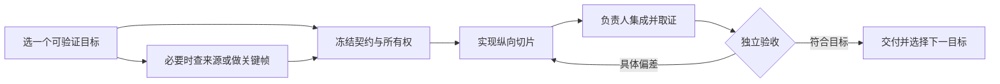

# StackLife 长线产品与验收路线图

StackLife 是用 Kotlin + Jetpack Compose 开发的、手机优先的原生 Android 日程工具。**队列**回答「我现在要做什么」，**栈帧**记录「我为什么停下、怎样接回去」。**DAG** 决定为选定目标先做什么，**时间轴**决定哪天几点做，**课表**标出已经占用的时段。一项工作不因换视图而变成几份任务。

**当前交付：M4 流程图。** 在画布或依赖列表编辑模板，选定目标、核对顺序与原因后直接生成新栈帧，不经过当前队列。v0.3.2 可原地升级。今天用单条时间竖轴，今天和工作台的右下角圆形 `+` 均独立于悬浮导航。手机课表提取和文件导入仍先核对再写入，Chrome 浏览入口独立，未使用真实校园账号验收登录后的提取。对话、玻璃及联盟转场仍属 M5–M6。

## 起点与产品决定

- 规划时仓库仅有 `.git/`，无可迁移的 App 或项目级 Agent 文件。架构从 [Android 官方建议](https://developer.android.com/topic/architecture/recommendations) 起步，不复制大型示例的模块拓扑。
- 本文的 `../WadwaitaUp/…` 均相对 **StackLife 项目根目录**。`browser.py:37–62,103–169` 有真正的 HUB/Vue 提取路径；`models.py:33–62` 有夏/冬两套 12 节表。这是桌面来源，不是可装到 Android 的插件。
- 规划时本机有 Android Studio、`adb`、JDK 17/21，系统默认 Java 27。`~/Android/Sdk/platforms` 仅有 `android-36.1`，37.0 的 x86_64 镜像目录仅见 `.installer`，`~/.android/avd` 为空。不能当成可启动设备；规划阶段未装 SDK、未启设备、未运行应用。
- 恢复默认按帧内原序插队首，可改队尾或整帧切换，不得覆盖眼前未完成的工作。「顶级」指**选定的目标事件**：取前置及目标本身的合法顺序，不做截止时间倒排。
- 日程留在设备，LLM 采用用户自填 OpenAI 兼容地址、模型和密钥（BYOK）。「接口」指 UI 和模型共用的完整**本地业务接口**；不监听端口、不向外部客户端开放。模型可查、可提案，不能自己确认写入。无账号、云端网关或云同步前提。
- 华科网页导入参照 [WakeUp 的教务导入流程](https://www.wakeup.fun/doc/import_from_eas.html)：手机登录、进入课表、点提取、核对。只借交互，不复制源码。网页和本人导出的 JSON 共用 Kotlin 解析器和确认事务；不采集密码、Cookie，不把校方页面给模型。

## 交付顺序

|阶段|依赖|可验收的用户结果|
|---|---|---|
|M0 约束落盘|无|根 `AGENTS.md` 提供执行入口，`docs/roadmap.md` 保存产品契约、依据、里程碑与验收表。只留两份长期文档。|
|M1 可以放心中断|M0|可安装的原生应用：真实队列、带原因的持久栈帧、整帧/部分恢复及三种策略。从第一屏使用 Expressive 主题和 fumo 图标；只显示已可用的目的地。|
|M2 安排今天|M1|从同屏托盘把队列任务拖到当天时间轴，时间选择器可做等价操作。|
|M3 课表占位|M2|华科用户本人登录或选文件，预览、导入、看周课表；课程占用同一条日程轴。|
|M4 从目标拆解工作|M1；与 M2 独立|手绘编辑 DAG，预览所选目标的前置顺序，一次生成新栈帧，不扰动队列。|
|M5 用对话改真实日程|M1–M4|各业务页可打开轻量对话，BYOK、受限查询、一次确认整批写入；不配网络也能手动使用。|
|M6 自定义与系统动效|M1–M4；助理入口材质验收需 M5|完整外观设置、可开关的局部折射、联盟 SharedView Kit 适配与真机流畅性验收。基础无障碍和应用内转场从 M1 就做。|

## 原生底座与本地事务

从 M1 随切片增加，不先造一套空框架。只建一个生产 `:app`，包名 `io.github.nakanomk.stacklife`。主 Activity + 按功能分包的 Compose 屏幕；只有联盟系统路径另需一个不导出的详情 Activity。应用级容器做构造器注入；ViewModel 暴露 `StateFlow`，页面用 `collectAsStateWithLifecycle()`。不建服务端、微服务、动态插件框架或每按钮一个 use case。

|构建面|规划锁定与依据|
|---|---|
|平台与界面|`compileSdk 37.1`、`targetSdk 37`、`minSdk 26`（涵盖联盟 Kit 下限）。[Compose 稳定发布](https://developer.android.com/blog/posts/jetpack-compose-november-2026-release)对应 BOM `2026.11.01` / Compose `1.13.0` / Material3 `1.5.0`。|
|工具链|[AGP 9.5.0 / Gradle wrapper 9.6.0 / JDK 17](https://developer.android.com/build/releases/agp-9-5-0-release-notes)，用 [AGP 内建 Kotlin](https://developer.android.com/build/migrate-to-built-in-kotlin)；Compose 编译插件和序列化插件统一 Kotlin `2.4.10`，KSP2 `2.3.14`。|
|导航与存储|[Navigation 3 `1.2.2`](https://developer.android.com/jetpack/androidx/releases/navigation3)、[Room `2.8.5`](https://developer.android.com/jetpack/androidx/releases/room)。版本集中在 `gradle/libs.versions.toml`，不用 `+`、snapshot 或 beta BOM。|

本地入口在 `app/src/main/java/io/github/nakanomk/stacklife/planner/PlannerApi.kt`。`discard` 只撤销未消费的内存提案，不写业务表：

```kotlin
interface PlannerApi {
    fun observe(query: PlannerQuery): Flow<QueryResult>
    suspend fun preview(commands: List<PlannerCommand>): PreviewResult
    suspend fun commit(proposalId: String): CommitResult
    fun discard(proposalId: String)
    fun stageCourseImport(term: TermSpec, meetings: List<CourseMeeting>): String
    fun discardCourseImport(draftId: String)
}
```

- `PlannerQuery`、`PlannerCommand` 为封闭类型，随里程碑加入真实操作。Compose 订阅 Flow，对话只取一次。UI、导入器、LLM 不直接拿 DAO。明确的手动点击可在内部连续预览/提交，无额外确认框；模型**没有 `commit` 工具**。需选文件、登录、授权等动作返回 `UserActionRequired`，不可报成已完成。
- `preview` 在同一读快照中按顺序校验整批命令，分配批内新增实体的 ID，算出明确增删改和 `baseRevision`。已声明的批内唯一别名可供后续命令引用；未声明、重复或歧义则拒绝。不可变提案及差异只留本机内存，不写业务表。
- M3 两个 `stage/discardCourseImport` 草稿方法只接收本人已核对的课次，在设备内存中临时登记；原始 JSON、网页登录数据不进 `PlannerApi`。预览取得独立差异后即释放输入草稿，未确认不改 Room。
- `commit` 只消费本机生成的对应提案。Room 写事务复核全局业务修订号，仅落下已预览的变更，修订号加一。过期返回 `STALE_PREVIEW`，须重新预览；不再询问模型决定写什么。重复点不能生第二份，取消/进程死亡丢弃未确认提案，中途失败整批回滚。校验只写一处。
- 非敏感外观与恢复偏好放在同库一行，保证与日程混合写入时仍能原子提交；密钥不进 Room。应用私有空间持久化，日程、登录数据与密钥不进系统云备份。Room 升级写迁移，不销毁重建。自行实现的是本项目的归属/快照、命令语义和交互连接；画布、主题、布局、解析依据与材质均有下列参考。

## M1 工作台

**一份任务，一个当前归属，一份可回看的现场。** `Task` 有稳定 ID、标题、备注、预计分钟、归属、位置；归属只有 `QUEUE / FRAME / DONE / REMOVED` 之一，仅 `QUEUE` 有队列序号，仅 `FRAME` 有当前帧 ID。`Frame` 记原因、保存时间、来源；`FrameItem` 记帧 ID、原位置、任务 ID、当时的标题/备注/时长以及当时已有的排程起止。历史项只读，不随任务编辑回写。删除用移出标记，不级联删帧历史；只有任务仍归该帧时才可恢复。

工作台分「队列 / 栈」。队列可新增、编辑、完成、移出、拖排/菜单移动；显示未完成数及预计总时长。队首是当前优先项，不强制计时；显示排程也不按时间重排队列。标题非空，预计时长为正，未填默认 30 分钟。手柄借 [Reorderable 3.1.0](https://github.com/Calvin-LL/Reorderable) 的稳定 key、拖动、边缘滚动，结束才提交新次序。栈按保存时间倒序，最新可恢复帧优先；原因作标题，显示保存时刻、原始项目和剩余数。取空的帧仍可看历史，也可在栈内直接新建一帧事件清单。

- **压栈：**默认选整个未完成队列，显式多选只压所选。原因必填且非空。按队列原序在同一事务建帧、写快照、移动归属，保留其余项相对顺序；空集合、空原因、选项失效都不建帧。不复制任务 ID；再次压入形成另一帧。
- **恢复：**手动「全部恢复」一次执行；「选择恢复」按帧内源序而非勾选顺序。已取走/完成/移出的项不复活、不重复。操作与预览均说明实际策略。空帧即使连点也不触发切换。

|本机偏好|全部恢复帧 `[A,B]` 到当前 `[X]`|选择恢复|
|---|---|---|
|`PREPEND`（默认）|`[A,B,X]`|所选按原序插队首。|
|`APPEND`|`[X,A,B]`|所选按原序加队尾。|
|`SWAP`（整帧切换）|`[A,B]`；先把 X 存为原因「切换栈帧前自动保存」的新帧。|始终插队首；只选 B 得 `[B,X]`，不另存 X。|

只有「全部恢复」且策略为 `SWAP` 且当前队列非空，才自动保存眼前队列，与恢复同一事务；失败/取消不改队列、两帧或次序。**占位独立于工作归属**：压栈保留预约，轴上注明「已压栈 · 仍占用时段」；恢复不复制、不改时，旧快照不覆盖用户后来的安排。

## M2 今天

完整导航为「今天 / 工作台 / 流程图 / 课表」，设置从顶栏进；只展示已交付目的地。今天默认设备所在日期，顶部切换日期并显示当前时刻线。底部可收起的**非模态**待排队列托盘与单日轴同时可见；待排指无时段的在队任务。参考 [Structured](https://structured.app/visual-planning) 的任务/日历同轴和 [Planner Hours](https://github.com/baslawson/Planner#features) 的移动、调整时长；不移植 GPL 应用代码。无须跨目的地拖动或引入月历框架。

- Compose 可滚动刻度接[原生拖动手势](https://developer.android.com/develop/ui/compose/touch-input/pointer-input/drag-swipe-fling)。长按拖动，边缘滚动；指针换算为含滚动偏移的轴内容坐标，按 5 分钟就近吸附。预览半透明落点、起止与冲突。松手才落库；轴外、取消、目标失效不改原数据。「安排时间」打开同一日期/时间/时长编辑器，无需拖动也可完成全部安排。
- `TimeBlock(taskId UNIQUE, startInstant, endInstant)` 引用原任务。新排或移动只动该占位，不出队、不复制任务；轴上可拖改开始、在编辑器改时长/取消。取消只释放时段；移出任务释放占位，完成任务保留标完成的历史块。
- 用当地午夜到次日午夜换算一天，不假定恒为 24 小时。跨日按日裁剪显示，底层仍一条；课程按学期换算到同一时间基准。冲突按半开区间 `[start,end)`，移动排除自身。撞已有预约或固定课程须指出具体冲突并保留原状，不推走别项。课程导入撞上既有块则预览、标记双项，不抹掉用户安排。

已实现 `PlannerQuery.Day(date, zone)`：一次事务读出同修订号的待排队列与当日相交的原始时段。`SlotSet(taskId, start, durationMinutes, expectedRevision)` 新增或移动，`SlotClear` 只释放占位；拖动读到的旧修订不可覆写新日程。两条界面路径共享 `preview/commit`。编辑器标明时区，拒绝不存在的当地时刻；秋季同一时刻出现两次时可选 UTC 偏移。Room v2 只新增占位表和索引，没有新增运行依赖。

## M3 华科课表

编译期登记 `HustCourseImporter`（插件 ID `hust-hub`）。`CourseImporter.parse(rows: JsonArray, term: TermSpec): ImportDraft` 是纯 Kotlin，无网络、DAO 或密码。只支持两条已知输入，两路共用解析/预览：

1. 「从 HUB 网页提取课表」在手机内打开[校方登录页](https://hubs.hust.edu.cn/login)。本人完成认证后点「总课表」，选学期，点「提取」进入学期确认，无需电脑或中间文件。`app/src/main/assets/importers/hust-hub.js` 的 Vue 父链查找依据 `../WadwaitaUp/browser.py:37–62`。
2. Android 系统文件选择器选本人导出的原始周数组 JSON；格式依据 `../WadwaitaUp/tools/hust_converter.py:6–16,84–100`。不架中转服务，不承诺兼容未核实格式。

**独立浏览。** 「用 Chrome 浏览 HUB」通过 [AndroidX Browser 1.10.0](https://developer.android.com/jetpack/androidx/releases/browser#1.10.0)（Apache-2.0）打开真正的 [Chrome Custom Tab](https://developer.chrome.com/docs/android/custom-tabs/guide-get-started)，使用 Chrome 自己的登录态、证书策略与导航。只打开固定的登录入口，不传正在使用的认证 URL。Chrome 不向宿主开放校方 DOM 或 Cookie；这个入口用于浏览，不是提取器。

**浏览与提取分开。** 手机提取器用 [Android System WebView](https://developer.android.com/reference/android/webkit/WebView)。HTTP/HTTPS 页面及跨域验证交给 Chromium，不设校方域名白名单，不改写重定向。HTTP 是明文，App 不会把它变成安全连接。第三方登录 Cookie 仅限该会话；保留系统证书验证，不注册原生 JS bridge。只有当前显示的页面是 [HUB 总课表](https://hubs.hust.edu.cn/basicInformation/scheduleInformation/index) 且用户点提取，才运行 APK 内脚本；只取周次、日期、星期、课名、节次、教室。导航或换学期会使未完成的提取失效。

退出提取器清理其 WebView 站点数据，不清 Chrome 数据，也不代替校方登出。给用户安装的包用 `./gradlew :app:assemblePreview` 构建，路径为 `app/build/outputs/apk/preview/app-preview.apk`，不可调试、与上一版同签名。`debug` 包只用于开发。

**从原始行到实际上课日期。** `ZC` 为周序，周集合去重排序。按周保留课名 `KCMC`、星期、节次 `JC`、教室 `JSMC`；仅完全相同条目去重，同课换教室不能并掉。`JC` 完整匹配单节或数字区间，支持 `-`、`–`、`—`；倒序、越界、「实践」均保留原文待修正，不默认为第一节。`KS` 只是第一周日期候选。用户确认学期标识、首周周一、总周数和夏/冬作息，可指定中途切换作息的生效日，不猜当年校历。按 `Asia/Shanghai` 实际上课日期套用 `../WadwaitaUp/models.py:33–62` 的两套 12 节预设；来源没有的教师等字段留空。

**写入边界。** 展示差异、有效/待修正数、同名不同地点和冲突；有问题的条目须修正或明确排除。无课或无有效数据不得覆盖已有课表。确认后仅替换所选学期 `hust-hub` 来源的课程集合；相同内容重复导入无新增，不动用户任务、其他来源或学期。**不移植** `../WadwaitaUp/window.py:3155–3188` 的 `_apply_imported_courses` 按课名跳过/覆盖；同名不是身份。移除某学期课表也须预览，不删除工作台内容。

单次导入预览先计数，再生成冲突明细。超过 256 对受影响的重叠时，提示检查源文件，不截断课次后提交；课名和教室各限 256 个 UTF-16 单元，超长进入可修正条目。日/周视图中一门课超过 8 个冲突对象时显示确切总数，避免把大量课程两两展开。

**阅读与失败路径。** 周网格用 [Android Week View 5.1.2](https://github.com/tobiasschuerg/android-week-view/tree/5.1.2) 的 `WeekView` / `WeekLayout.Periods`；JitPack 限该依赖组，锁 tag 和制品校验值。周次可切换，点课看教室、节次和周次。网格只读，不承担跨托盘拖放；当天实例在同一轴上为锁定块。Vue 字段非公开协议；未登录、未加载、结构变化、SSO 拒内嵌、校园网不可达，应指出原因、保留现有课表并提供真实文件入口。文件通过不代表在线登录通过。

**许可。** 移植部分随附 `../WadwaitaUp/LICENSE` 完整 MIT 文本及 `Copyright (c) 2024–2026 Nakanomk`；不携带个人样本。

## M4 流程图

节点是计划模板，不是已有队列任务。存图、节点（标题、备注、预计时长、创建顺序、画布位置）和有向边（前置 → 后继）。画布可新建、改名、拖动、连线、删边/节点、平移缩放；手机另有点选两节点连线和可朗读依赖列表。删节点一起删关联边，不反向改写已生成任务与帧。

- 画布使用 [KotlinFlow 1.0.1 / MIT](https://repo.maven.apache.org/maven2/io/github/joaonart/kotlinflow/1.0.1/) 绘制有向边并处理平移、双指缩放与全图适配；不引示例皮肤、不当数据库。该版本内建节点拖动把取消和松手交给同一回调，`onConnect` 不派发；节点移动、箭头拖到后继的命中及取消由应用适配。库用物理像素，节点位置按 dp 保存。领域层拒绝自环、重复边、缺失/跨图端点、会成环的边；说明具体冲突，不留半条边或部分生成物。
- 选一个目标，取其**传递前驱和自身**的诱导子图，稳定拓扑排序；并列就绪节点按创建顺序，再按 ID，不用坐标或画布排版决定优先级。用 [JGraphT Core](https://jgrapht.org/) `org.jgrapht:jgrapht-core:1.5.3`（上游双许可，按 EPL-2.0 保留许可与来源）：`DirectedAcyclicGraph.addEdge/getAncestors`、包含目标的子图、带显式比较器的 [`TopologicalOrderIterator`](https://jgrapht.org/javadoc/org.jgrapht.core/org/jgrapht/traverse/TopologicalOrderIterator.html)。拖节点只保存布局。
- 先看有序清单再「生成栈帧」；默认原因「为目标〈标题〉生成」，可改非空。一次事务生成一帧、新任务实例及有序快照，不经过当前队列。未选目标不能生成，孤立目标一项，菱形前置只出现一次。再次主动生成是新帧，重放同一确认不是；生成顺序不限制之后选择恢复其中几项。

## M5 对话

业务页面共用应用内 `AssistantSheet`，非系统悬浮窗。入口说明当前语境，如「问今天」「问这个栈帧」，绑定日期/选中实体 ID；作用域变化可见。打开仍看得见原页，可展开、收起、取消，避开键盘和手势区。从任何业务页都能发起组合操作。未配置引导设置，不模拟回答；校方登录与密钥编辑不共享屏幕内容。

**连接。** 用 OkHttp `5.5.1` + `kotlinx.serialization`。用户提供含 API 前缀的 HTTPS base URL、模型、Key；在 base URL 后追加 `chat/completions`。使用 [OpenAI 兼容 function tools](https://platform.openai.com/docs/guides/function-calling) 和 `tool_calls`，不从散文猜命令；模型必须支持这套协议，只支持 Responses 的不冒充兼容。用 [Android Keystore](https://developer.android.com/privacy-and-security/keystore) 中不可导出的 AES-GCM 密钥加密 BYOK，每次写用新 IV，密文放私有 `noBackupFilesDir`。换服务域需重新授权/填 key，不跨域转发鉴权。无账号、无托管中转、无后台自动操作。

**仅两种模型工具。** `planner_query` 限定类型、范围、字段，可查当前队列、帧/清单、图/目标次序、某天占位、某学期/周课表及普通设置；只读本轮获准范围。`planner_propose` 传一次有序命令数组。下表 `kind` 也是 UI 命令的序列化名。不提供 raw SQL、任意 URL/文件、脚本执行、任意 UI 点击或确认按钮；隐私、连接配置、认证、系统选文件都要显式用户操作。

|领域|写命令与关键输入|
|---|---|
|队列 / 栈|`task_add`（每项一条，可成批）、`task_edit`、`task_finish`、`task_remove`、`queue_order`（当前完整 ID 排列）；`frame_create(reason, tasks)`、`frame_push(reason, taskIds)`、`frame_restore(frameId, mode, taskIds)`。`mode=all/selected`；是否切换队列由本机偏好决定。|
|DAG|`graph_create`、`graph_patch`（按 ID 增改删节点、位置、边）、`graph_remove`、`graph_frame(graphId, goalId, reason)`。新实体可声明批内唯一 `ref`；`graph_frame` 还可声明新帧 `ref` 和 `taskRefs`（图节点 → 新任务别名），让「生成 → 选取 → 排程」不猜数据库 ID。|
|日程 / 课表|`slot_set(taskId, start, durationMinutes)` 新排/移动，开始时间须带 offset；`slot_clear(taskId)`；`course_import(draftId)`、`term_remove(termId)`。模型可请求打开导入器；无经用户核对的本地草稿 ID 不得凭空导入。|
|外观 / 偏好|`prefs_set`、`prefs_reset` 只接受已公开的外观/交互字段与合法值；重设只动所选组。配置凭据或扩大披露范围不能走模型授权捷径。|

**数据披露。** 首次联网及扩大范围前展示要发往哪个域、哪些字段。默认只有当前范围的任务标题、顺序、时段和必要 ID；课表默认只给忙碌时段。备注、压栈原因、课程名/地点须用户明确纳入才出设备。整库、原始课表、Cookie 永不发送；BYOK 仅作绑定服务的鉴权头，不进提示词/工具结果。课程名、备注和模型输出都是不可信文本，不是权限指令。对话限会话内，日志不落原文；关闭/取消终止在途请求。

**谁能提交。** 纯查询直接答。每轮所有写操作合为**一张差异卡**，列项目名、顺序、旧 → 新时间、实际生成的节点/边/帧或受影响设置。模型没有 `commit` 工具；只有用户点一次「应用这些更改」，手机才消费对应本地提案，收到事务回执才说「已应用」。校验失败、重名歧义、空结果、协议不兼容、401、限流、超时、取消均给具体反馈，不写业务项。每条消息最多四次只读往返，写提案返回即停；不运行自主后台 Agent。

## 设计与外观

基线是 [Google Material 3 Expressive（2025 起）](https://blog.google/products-and-platforms/platforms/android/material-3-expressive-android-wearos-launch/) 和 [Compose Material3 稳定线](https://developer.android.com/jetpack/androidx/releases/compose-material3)。用官方色彩角色、强调字级、形状层次、按钮组和 motion scheme；强调色留给「现在」、选中项和本屏主动作，正文用实色。不以 2025 年前截图定视觉，不另造仿 iOS 行为。

- 默认浮动胶囊**实色**导航，保留目的地标签、选中态与焦点，另可选贴底标准导航。顶栏助理/上下文工具与主导航分开；小屏不塞双排悬浮按钮。队列突出首项，帧用原因作标题；DAG 仅选中节点显示编辑操作；课表用周/节次索引，固定块有文字/图标，不只靠颜色。宽窗可并列托盘/内容，紧凑手机、横屏、大字体不丢入口。
- 设置分「色彩」「布局」「材质与动态」「工作台」。色彩可跟随系统/浅/深，Android 12+ 系统动态色或自选种子（默认靛蓝 `#435D92`）。自选色用 [MaterialKolor 6.0.0](https://github.com/jordond/MaterialKolor/releases/tag/6.0.0) 的 `material-kolor-core`、`rememberDynamicScheme` / `MaterialKolors`，把 `SPEC_2025` 角色交给 AndroidX `ColorScheme`，不引带另一套 Material 依赖的适配层；按种子、亮暗和对比度记忆色板。
- 标准/紧凑密度只减非交互留白。可调四个目的地次序/启动页、任务时长/备注副标题显隐、贴底/浮动、玻璃总开关和导航/助理分项、跟随系统/减弱动画、减少透明度、增强对比、触感随系统/关闭。三种恢复偏好独立于外观重置。外观实时预览、可取消/恢复默认，保存后跨启动生效。默认舒适密度、今天启动（目的地可用后）、动态色（不可用取品牌种子）、玻璃关闭、随系统动效。以 [Google Core App Quality](https://developer.android.com/docs/quality-guidelines/core-app-quality) 的一致交互、横竖屏功能对等与后台恢复为底线。
- 首发图标为原创 fumo 颜文字 **`ᗜˬᗜ`**：两只对称方眼和低位短弧嘴，用独立矢量笔画，不依赖字库、商业布偶照片，不强画天子肖像。按 [Android Adaptive Icon](https://developer.android.com/develop/ui/views/launch/icon_design_adaptive) 做 108×108 dp 分层，识别区在中心 66×66 dp，彩色前景/背景及 monochrome 层共用轮廓，不预烘启动器圆角/阴影。空队列小标沿用同一张脸，不用颜文字代替操作标签。

**交互参考与借用边界：**

|来源|具体借用点|
|---|---|
|[BiliPai 外观](https://github.com/jay3-yy/BiliPai/wiki/Guide-Appearance) / [设置实现](https://github.com/jay3-yy/BiliPai/blob/main/app/src/main/java/com/android/purebilibili/feature/settings/screen/AnimationSettingsScreen.kt) / [材质实现](https://github.com/jay3-yy/BiliPai/blob/main/app/src/main/java/com/android/purebilibili/core/ui/popup/AppGlassSurfaceMaterial.kt) / [LiquidGlassSettingsStore](https://github.com/jay3-yy/BiliPai/blob/main/app/src/main/java/com/android/purebilibili/core/store/home/LiquidGlassSettingsStore.kt)|总开关 + 场景开关 + 能力门控，实色与透明分离、偏好与渲染分离。Kotlin/Compose、GPLv3；不复制代码、shader、资源、存储实现，不照抄 beta BOM/snapshot 依赖。|
|[Breezy Weather](https://github.com/breezy-weather/breezy-weather) / [Auxio](https://github.com/OxygenCobalt/Auxio)|今天页的概要/细节排版；当前任务与队列之间的入口（Auxio 是原生 Views，不是 Compose）。|
|[Metrolist](https://github.com/MetrolistGroup/Metrolist) / [Mihon](https://github.com/mihonapp/mihon)|助理从收起到展开的层次；队列手柄及移动到顶/底。|
|Flutter [PiliPlus](https://github.com/bggRGjQaUbCoE/PiliPlus) / [LocalSend](https://github.com/localsend/localsend)|中文标签分组、多选排序；单一目的操作。只借信息结构，不搬旧视觉、播放器架构或插画。|

**时间轴与底栏的具体取舍。** [Structured 的日视图](https://help.structured.app/en/articles/380546)在一根竖轴左边标时刻，右边读事件；StackLife 保留按时间比例的空白，供五分钟拖放。参考 [BiliPai 的导航外壳与选中指示器](https://github.com/jay3-yy/BiliPai/blob/8392b7de4a21c37252858986dc7c96e17826e768/app/src/main/java/com/android/purebilibili/feature/home/components/FloatingBottomBar.kt)和 [Etar 的 bottom/end FAB](https://github.com/Etar-Group/Etar-Calendar/blob/6fb46d1606622aecc719b7e5dc15a48528768c94/app/src/main/res/layout/all_in_one_material.xml)：导航胶囊独自在底部居中，选中指示器在槽位间滑动。圆形 `+` 属于上方页面，不占导航槽位：竖屏今天页浮在时间轴右下、托盘上方；工作台队列浮在列表右下，末项能滚到按钮上方。栈和周课表不显示新增任务。图标自行绘制，折射仍属 M6。

手机关键帧规格（示意，不是应用截图）：

```svg
<svg xmlns="http://www.w3.org/2000/svg" viewBox="0 0 360 390" font-family="sans-serif" font-size="14" fill="currentColor">
  <rect x="5" y="5" width="350" height="380" rx="26" fill="none" stroke="var(--border)"/>
  <text x="24" y="46" font-size="26" font-weight="bold">今天</text><text x="94" y="44" fill="var(--muted)">周一</text>
  <rect x="241" y="18" width="91" height="44" rx="22" fill="var(--surface)" stroke="var(--border)"/><text x="262" y="46">问今天</text>
  <path d="M78 82 V231" stroke="var(--border)" fill="none"/><text x="20" y="99" fill="var(--muted)">14:00</text>
  <rect x="92" y="80" width="236" height="71" rx="17" fill="var(--surface)" stroke="var(--border)"/>
  <text x="106" y="107" font-size="17" font-weight="bold">操作系统</text><text x="106" y="133" fill="var(--muted)">课表 · 固定到 15:35</text>
  <circle cx="78" cy="171" r="4" fill="var(--accent)"/><path d="M78 171 H328" stroke="var(--accent)"/><text x="25" y="175" fill="var(--accent)">现在</text>
  <rect x="92" y="185" width="236" height="42" rx="12" fill="none" stroke="var(--accent)" stroke-dasharray="4 4"/><text x="106" y="211">15:45–16:15　报告提纲</text>
  <text x="24" y="262" font-weight="bold">待排队列</text><rect x="24" y="274" width="306" height="43" rx="14" fill="var(--surface)" stroke="var(--border)"/><text x="38" y="301">报告提纲 · 30 分钟</text><text x="278" y="301" fill="var(--muted)">拖动</text>
  <rect x="22" y="331" width="312" height="44" rx="22" fill="var(--surface)" stroke="var(--border)"/><text x="47" y="359" fill="var(--accent)" font-weight="bold">今天</text><text x="113" y="359">工作台</text><text x="194" y="359">流程图</text><text x="274" y="359">课表</text>
</svg>
```

## 动效与材质

**应用内连续性（从 M1 起）。** 按稳定实体 ID 做 [Compose shared bounds / shared elements](https://developer.android.com/develop/ui/compose/animation/shared-elements)：事件卡片 → 详情、栈帧 → 帧详情，同一对象容器转换。源不在/被过滤则淡出，不飞向占同一位置的另一张卡片。[Navigation 3 预测返回](https://developer.android.com/guide/navigation/navigation-3/animate-destinations) 随手势可取消，保留列表位置，根页不拦系统返回桌面。动画不触发业务写入。系统动画比例为 0 或选择「减弱」时直接切换/简短淡变，停弹性和装饰循环。

**联盟系统能力（M6 单列验收）。** 依据 [ITGSA SharedViewDemo](https://gitee.com/itgsa_sharedviewkit/SharedViewDemo)。`gsai.sdk:sharedview-kit` 运行时调用 `ViewAnimationManager.isViewAnimationSupported()`，不按品牌猜。仅在协议支持、动效允许、源卡片完整可见时，对队列事件/栈帧卡片用非导出 `EntityDetailActivity`，复用同一详情 Composable，Intent 只传实体类型和 ID。用 `PixelCopy` 取被点卡片的 window 矩形，不把整屏 `LocalView` 当卡片。按 Kit 能力约定区分屏幕/窗口坐标、转换 bounds，圆角转 px，交给 `makeViewAnimationOptions(bitmap, bounds, radius, …)`；成功只让系统播一次。返回按实体 key 刷新落点，在详情 Activity 的 `finish()` **之前** `overrideViewAnimationTransition`；源丢失跟随系统。能力为 0、options 为空或取图失败，走同一应用内详情路径，不叠动画、不阻断导航。

依赖候选为[官方 HTTPS 固定提交的 1.0.0.5 AAR](https://gitee.com/itgsa_sharedviewkit/SharedViewDemo/tree/b449a426a340f1827d942592bddf0a416eae3ac4/app/libs)；核对来源/授权，记录并校验 SHA-256，不用示例的 HTTP 内测 Maven 或动态 `+`。[NOTICE](https://gitee.com/itgsa_sharedviewkit/SharedViewDemo/blob/master/NOTICE) 的 MIT 只覆盖示例，SDK 授权另计。**正式分发许可和真实支持设备均未核实。** 许可明确后才以单一发行包按能力分支；此前不得分发含 SDK 的包，普通版只含真实 Compose 转场。联盟验收仍受阻，模拟器截图不能证明系统 OPEN/BACK，更不能称已支持或已获金标认证。

**可选光学层。** `StackLifeSurface` 保持同一 Material 组件、焦点与布局，唯一折射后端取 [Haze 2.1.0 Glass](https://github.com/chrisbanes/haze/blob/2.1.0/docs/effects/glass/index.md)（Apache-2.0，`haze` / `haze-glass` 同版）。只在导航胶囊和收起的助理胶囊使用 `GlassStyle.regular`、官方主题 surface 色、`HazeInput.Sources`、`HazeSourceRetention.ClearWhenUnavailable` 做折射和高光。不另配一套颜色、不叠全屏滤镜、不用实验性 window backdrop。长对话、恢复清单、登录页、时间轴正文和 DAG 节点均实色。是可选皮肤，不称 Google 官方材质。

玻璃仅在 API 33+、硬件加速、非低内存/省电、无减少透明度/高对比要求时可用。否则提示「当前使用实色」及原因，不把模糊称为折射；关玻璃完全卸下光学层。按 [Google 无障碍标准](https://developer.android.com/guide/topics/ui/accessibility/apps)，触控目标至少 48×48 dp，普通文字对比 4.5:1、大字 3:1；TalkBack 读状态并有等价非拖拽操作。系统字体缩放、edge-to-edge 安全区、输入法和旋转都不能遮操作。减少动态与减少透明度分开处理。

## 研发分工与交接

这些是**开发职责**，不是手机里运行的 Agent 群。根 [AGENTS.md](../AGENTS.md) 是短入口；任务契约放 Issue/当前会话，只写一个结果的目标、参考及许可、写集与依赖、不改什么、输入 → 可观察结果。

|角色|职责与交接物|
|---|---|
|负责人 / 集成 Agent|给验收输入和预期，冻结接口、写集；维护公共构建、schema/迁移、根导航和契约。集成后对实际证据负责；小改可兼任实现。|
|研究 / 交互 Agent（按需、只读）|仅在新视觉、平台 API、外部格式需要时介入，给一手链接/本机位置、借用点、许可和关键帧/失败路径，不另造架构或重开已批设计。|
|实现 Agent|限域交付数据 → 命令 → 界面 → 相关用例的纵向切片，沿用已选组件；共享契约冲突交回负责人。给可复现输入与未验项，不自行宣布验收。|
|独立验收 Agent（只读）|先看漏做/多做，再看质量与运行证据；UI 看截图，动效看录屏，数据看事务后与重启状态。只给「通过 / 需修复 / 证据不足」，不验收自己的实现。|



默认单实现者。接口冻结、切片独立且写集不相交、确能减少工作才并行，常规最多两位；如 M2 轴和 M4 画布可分包，但两方不同时改 Room 迁移/根导航。按本项目、官方组件、授权库、最小适配的顺序找实现；新依赖/模块/抽象须对应当下缺口。禁止假数据、假回复、假成功与为过检查弱化断言。负责人收集最窄真实证据放 PR/会话，不提交私密样本，不建每轮目录或例会流水线。偏差以「要求 → 实际 → 偏差」退回实现者，同边界反复失败先修契约；缺条件只列该项未验。只在需决策的阻塞、验收点或完成时通知，不自动发布/合并；只为会复发的实际错误增补规则。

**依据及归属：**[Lauren Tan 署名的 xAI Engineering Lead 模板](https://x.ai/bot/marketplace/bots/engineering-lead)借的是沿用上下文、负责人跟到结果（派发不等于完成），不是她规定了以上角色。[xAI 工程实践](https://x.ai/bot/guides/grok-bot-for-engineering)作者是 Lingxi Li，借其证据回流。另参考 [Codex 的 AGENTS.md 约定](https://developers.openai.com/codex/guides/agents-md)作短入口、[GitHub Spec Kit 项目规则](https://github.com/github/spec-kit/blob/main/AGENTS.md)作规格 → 行为正反例、[Superpowers reviewer 契约](https://github.com/obra/superpowers/blob/main/skills/subagent-driven-development/task-reviewer-prompt.md)作先符合性后质量的验收顺序。[Android 官方 skills](https://github.com/android/skills)按具体 Compose/性能疑难查阅，不引入整套编排 CLI。

## 验收方法

**M0 不需要 Gradle。** 从根规则入口应能找到华科提取代码与许可，推演帧 `[A,B]` 恢复到 `[X]` 的结果，指出模型提案后谁能提交，以及解释为什么模拟器截图不能验联盟能力或证明金标认证。两文件可独立阅读、未把未实现项标为完成，即达到本轮目标。

**开发环境。** 安装 **Android SDK Platform 37.1**（不只是 `build-tools`）；工程 DSL 用 `compileSdk { version = release(37) { minorApiLevel = 1 } }`。启动专用 API 37 手机 AVD 或连接获授权的测试手机，`adb devices -l` 须见 `device`；不用个人主账号/日程做破坏性实验。项目已带校验分发包的 Gradle wrapper，在根目录执行：

```bash
export ANDROID_HOME="$HOME/Android/Sdk" JAVA_HOME=/usr/lib/jvm/java-17-openjdk
export PATH="$JAVA_HOME/bin:$ANDROID_HOME/platform-tools:$PATH"
./gradlew :app:installDebug
adb shell am start -n io.github.nakanomk.stacklife/.MainActivity
```

**M1 复现：** `./gradlew :app:connectedDebugAndroidTest -Pandroid.testInstrumentationRunnerArguments.class=io.github.nakanomk.stacklife.acceptance.WorkspaceTest,io.github.nakanomk.stacklife.acceptance.WorkspaceUiTest`。每个用例使用独立的文件型 Room 数据库；Compose 测试运行同一工作台和导航。数据库基线在 `app/schemas/`，后续变动须保留迁移路径。APK 在 `app/build/outputs/apk/debug/app-debug.apk`。

M1 首验在 Android 17 / API 37 x86_64 专用 AVD 上通过 12 项仪器测试，涵盖三种策略、过期/重复提案、第二条快照插入失败的回滚、部分恢复和拖排/菜单移动。保存中重建 Activity 的用例锁住真实 Room 写事务：表单只恢复请求 ID，续等 ViewModel 的原回执，放锁后只创建一项并退出；若进程丢失回执则提示核对，不重发命令。

安装包另经实际界面压栈、旋转和 `am force-stop` 冷启动：队列仍为 `[A,B,X]`，历史帧保留两项、剩余零项；取消系统返回手势仍在原帧详情，完成手势才回到栈。以上不代证实体机性能、TalkBack 实机体验或联盟能力。后续阶段的纯 Kotlin 用例可用 `./gradlew :app:testDebugUnitTest --tests '*GoalOrderTest'` 等按类选择，不预造空测试。

**M2 复现：** 在专用 API 37 设备运行 `./gradlew :app:connectedDebugAndroidTest -Pandroid.testInstrumentationRunnerArguments.class=io.github.nakanomk.stacklife.acceptance.DaySlotTest,io.github.nakanomk.stacklife.acceptance.DayTimelineTest`。前者覆盖事务、所有权、重开和当地日边界；后者向真实界面发送长按、移动、松开、取消及无障碍点击事件。连同 M1 回归共 **21 项通过**。其中一项在手指静止时推进帧时钟，检查边缘滚动改变候选时段；并发改动后松手不得写入。

**升级与无障碍实测：** 在 Android 17 x86_64 测试 AVD 保留 M1 安装数据，以 `adb install -r` 覆盖启动 v0.2.0；数据库版本 1→2。原四张业务表导出的 SQL 逐字节相同（5 个任务、3 个帧、7 条快照、修订 14），新占位表为空。在另一台 Google Play API 37 AVD 启用系统 TalkBack 17.0，实际触摸聚焦并双击「安排时间」，键盘输入 15:45；同一个队列 ID 经 16:00 改时、取消后仍在原位。会话附两条操作录屏；未评估语音播报质量或实体机性能。

**M3 复现：** `./gradlew :app:testDebugUnitTest --tests '*HustImportTest'`（7 项）；专用 API 37 设备运行 `./gradlew :app:connectedDebugAndroidTest`（含 M1/M2 回归共 33 项）。`CourseConfirmationTest` 在 Room 写事务被占用时确认导入/移除并重建 Activity，两次操作分别只写一次；`CourseConflictBoundsTest` 检查密集冲突拒绝时不改库。设备上从系统选择器导入 [`hust-week-acceptance.json`](../app/src/androidTest/assets/hust-week-acceptance.json)，明确排除 `实践`，确认前学期/课次为 0/0，确认后为 1/3，再导入仍三次。冬令当天拖到 15:00 被拒，同一任务在 15:35 紧接课程成功。v0.2.0 → v0.3.0 原地升级，五张原业务表 SQL 导出逐字节一致，保留 5 个任务、3 个帧和修订 14。

**v0.3.1 定向回归：** `HubLoginNavigationTest` 在真实 WebView 中用本地 HTTPS 响应复现「HUB → 第三方认证页（含另一域的脚本）→ HUB 总课表」，检查第三方不可提取、返回后可提取。`WorkspaceUiTest.addTaskFloatsAboveCenteredNavigationOnTodayAndInTheQueue` 检查圆形加号在胶囊上方且不挤偏导航，并从今天页实际创建一项队列任务。连同投影、Cookie 清理和拖放回归，API 37 设备定向 10 项通过；这些用例不替代本人认证后的在线验收。

**v0.3.2 手机导入：** Android 17 上实际点击「用 Chrome 浏览 HUB」进入 Chrome 145 的 `CustomTabActivity`；两个入口都从 HUB 到达 `pass.hust.edu.cn` 的「您正在登录HUB系统」表单，返回可回到来源选择。未输入校园账号。`HubLoginNavigationTest` 用本机 HTTP 302、跨站验证 Cookie 和用户点击打开的新窗口验证往返；`HubMobileImportTest` 在手机显示合成总课表，通过「总课表 → 提取 → 核对 → 确认」写入一门课，确认前 Room 未变。连同 `HubProjectionTest` 共 5 项设备用例通过；`HustImportTest` 7 项通过。v0.3.1 可覆盖安装。

**M4 复现：** `./gradlew :app:testDebugUnitTest --tests '*GoalOrderTest'` 验稳定排序与非法图；专用 API 37 设备运行 `GraphTransactionTest`、`GraphEditorTest`。事务用例还覆盖同批「建图 → 生成 → 部分恢复 → 排程」、旧修订/重复确认拒绝和最后一次写边失败时整批回滚。v0.3.2 → v0.4.0 原地升级后，七张旧业务表（含任务、帧、快照、占位与课表）的 SQL 导出逐表一致，新增图表为空。手机上可从依赖列表点选前置和后继，也可直接从节点箭头拖到后继；两者写入同一关系。

JVM 上 5 项排序用例、Android 17 上 6 项图相关仪器用例通过。触控覆盖重叠节点的连线落点、取消与过期拖动；确认期间重建 Activity，放开 Room 写锁后只生成一帧，再重建仍回到同一帧。Google Play API 37 AVD 实测空白处平移、双指缩放；启用系统 TalkBack 17.0 后，可聚焦「先做 A，再做 C」并双击选择 D、进入四项目标预览。不据此宣称实体机性能或语音质量。

|阶段 / 用例|输入 → 可观察结果（M1–M4 为回归用例；M3 真实账号提取另验，M5–M6 待开发）|
|---|---|
|M1 `WorkspaceTest`|新建 A、B、C，完成 C；以「去开会」压栈，添加 X。仅取 B 得 `[B,X]`，原帧仍显示 A、B 原序及原因，仅 A 可取；再全部恢复得 `[A,B,X]`。改 B 标题再压另一帧，旧快照不变。独立复位，对 `[A,B]` 帧与 `[X]` 队列分别验三种策略：队首 `[A,B,X]`、队尾 `[X,A,B]`、切换 `[A,B]` 且新帧只含 X；切换模式下选择 B 不新建帧。空原因/事务失败不移动任何项；连点、旋转、`adb shell am force-stop io.github.nakanomk.stacklife` 再启动均不重复、不丢任务。|
|M2 `DayTimelineTest`|待排「报告提纲」30 分钟拖到 15:45 → 显示 15:45–16:15，仍是同一队列 ID，只有一个块。改到 16:00 → 原块移动；取消排程 → 块消失，队列保留。用 TalkBack 的「安排时间」走同一路。压栈再恢复已排任务，时段不变。|
|M3 `HustImportTest`、`CourseTimelineTest`|自造周数组：首周周一 2026-09-07，第 1、3、9 周周一「操作系统」`JC="5–6"`，地点依次 A、B、B；周 1 重复一条，再加 `JC="实践"`。11 月 2 日起用冬表；待修正项不得成第一节。明确排除后，9 月 7 日显示 A 14:30–16:05，9 月 21 日显示 B，11 月 2 日显示 B 14:00–15:35。相同文件导两次仍三次课程，第 2 周为空。将任务拖入冬令课程 15:00 被拒，旧时段未动；15:35 可紧接安排。在线另须本人在获准设备登录 HUB，选学期、核对一门真实课再确认；遮挡身份/地点，不自动保存响应。|
|M4 `GoalOrderTest`、`GraphTransactionTest`、`GraphEditorTest`|依 A/B/C/D/X 顺序创建，画 `A→B, A→C, B→D, C→D`，选 D：预览并生成 `[A,B,C,D]`，不含 X，A 只一次；原队列不变。拖动 C 不改变次序；加 `D→A` 被拒且图/帧不变；仅选孤立 X 生成一项。生成后改图不改历史帧。|
|M5 `AssistantProposalTest`|从今天页要求「查资料→写提纲→交报告，生成栈帧，只把查资料恢复并安排 16:00」。无冲突时先只有差异，库不动；确认后一个三节点两边图、一帧剩两项、一项回队、一个时段；点第二次无新增。取消、预览后手动移动队列、401、工具参数无效、未获跨页数据授权，均不能静默写入。用测试专用录制响应/HTTP 测试端点复现边界，再以自愿提供的真实 BYOK 服务运行一次；测试替身不进生产。|
|M6 `AppearanceTest` + 真机|切浅/深、品牌/动态色、胶囊/贴底并冷启，布局/点击/偏好一致。360dp 宽、字体 200%、TalkBack、手势返回取消、低端禁玻璃都不丢主操作。同一滚动内容录开/关玻璃，支持档应能看见背景边缘折射。启动器圆形/方圆、单色主题均不裁脸。一台 Kit 能力 `>0` 的真机验 OPEN/BACK、快速打断、返回落点消失；一台能力 0 的设备照常进退。记录协议值、机型、系统和录屏，不记录事件私密正文。|

**M6 性能门槛。** 仅在 M6 建测试专用 `:macrobenchmark`；`benchmark` 构建继承 release、可 profile、仅装测试机，不拆生产模块。在固定真机/刷新率、同一份 30 项队列与一日课表，用 `./gradlew :macrobenchmark:connectedBenchmarkAndroidTest` 分别测玻璃开/关下滚动、卡片往返、面板开合，各五轮，使用 [FrameTimingMetric](https://developer.android.com/topic/performance/benchmarking/macrobenchmark-metrics)。API 31+ 测试机各可用档 `frameOverrunMs` P95 ≤ 0；不过只调/缩小有问题的光学表面再验，不以 debug 模拟器帧率宣称流畅。

**外部条件不互相代证。** HUB 在线登录、真实付费模型、联盟设备与 SDK 授权分别需要自己的证据。缺条件时仍保留原始文件导入、完整手动操作、普通 Compose 连续转场；只注明相应路径未验，不缩减路线图、不冒充通过。首个开发目标仍是离线可靠地中断和续做，不预设云同步、iOS 或开放 API。
